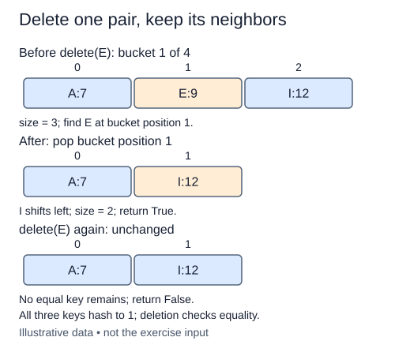

Deleting one label must not delete its whole bucket. Other labels may share that bucket and must remain retrievable.

The supplied put and get methods already establish how to choose a bucket and compare keys. In delete, enumerate the pairs so you retain the index of a match. Remove that pair with `bucket.pop(i)`, reduce size once, and return `True` immediately. Leaving the loop after removal avoids continuing over a list whose positions have shifted.

If the key is absent, return `False` and leave everything unchanged. This is intentionally different from get, which raises for a missing key. A boolean delete result lets a caller ask whether a removal actually happened. Deleting the same key twice should therefore yield true and then false.

For a separate trace, a bucket containing clay, sand, and lime loses sand. Clay and lime remain, with lime shifting one position left in this list-backed bucket. Removing the first or last pair should obey the same contract. An empty string is a valid key; it should not be confused with a missing one.

Searching costs O(b) for bucket length b, and removal from a Python list may also shift O(b) references. The total is still O(b), not O(1) merely because `pop` is one expression. Under a suitable distribution and bounded load, expected bucket work is O(1); all-collision worst-case work is O(n), plus hashing and equality costs. A linked bucket with a known predecessor could unlink in O(1), but finding that predecessor would still cost a scan.

The positions below the pairs are offsets inside bucket 1. They are not hash bucket indices.

## Your Tasks

1. Return `False` when no equal key exists.
2. Remove the matching pair and return `True` when it exists.
3. Decrease size once for each successful removal.

Edit `main.py` one step at a time. Run uses the supplied probe; an unfinished field or return value may print a reminder. Submit checks the numbered steps in order, so you can see each completed step before finishing the next.
