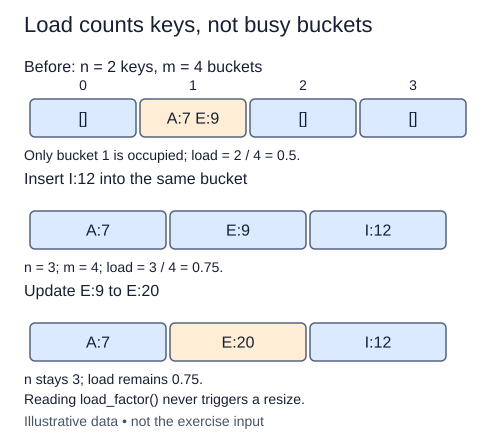

A table with many entries and few buckets usually makes longer bucket scans. Load factor measures that pressure: divide the number of stored keys by the number of buckets.

Use `size`, not the number of nonempty buckets. A table with six keys and three buckets has load factor two even if all six keys occupy one bucket. Separate chaining allows values above one because a bucket can contain several pairs. Load factor is an average occupancy, not a promise that every bucket has that length.

The constructor guarantees a positive bucket count, so this method never divides by zero for a valid table. Return ordinary `/` division as a float. Floor division would hide fractional loads: three keys in four buckets should report 0.75, not zero. An update to an existing key leaves load unchanged; successful deletion lowers it.

For a separate example, a table with five entries and ten buckets has load 0.5. That looks light, but a poor hash may still put all five entries together. Expected constant-time lookup requires a suitable distribution as well as bounded load. No single numeric threshold repairs every collision pattern.

Reading size and bucket length takes O(1) time and O(1) space. This lesson reports the measurement only; it does not trigger growth. The next lesson introduces explicit rehashing, which is a different operation with a larger cost. Keeping measurement separate from rebuilding makes it easier to see when a supposedly cheap table operation pays for a full migration.

Count keys in the numerator and all allocated buckets in the denominator. Updating E changes neither count.

## Build it in small steps

The constructor already guarantees a positive bucket count. This task is one ratio calculation, so it stays as one check.

## Your Tasks

1. Return `size / len(buckets)` from `load_factor`.

Edit `main.py` one step at a time. Run uses the supplied probe; an unfinished field or return value may print a reminder. Submit checks the numbered steps in order, so you can see each completed step before finishing the next.
