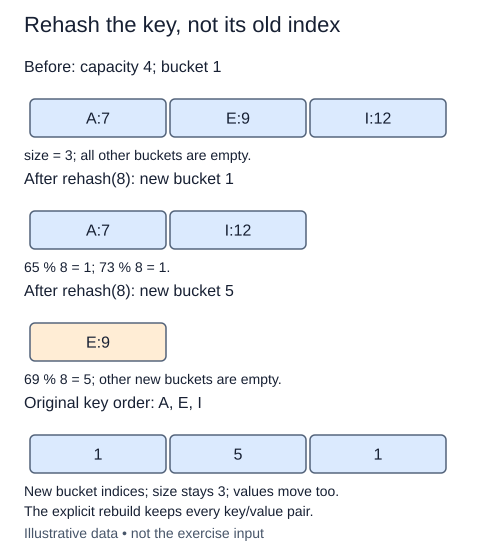

Changing the number of buckets changes the remainder calculation. A pair that belonged in bucket two before growth may belong somewhere else afterward. Extending the outer list is not enough: get would compute a new index and look in the wrong place for unmoved records.

Validate the new positive integer capacity before touching the table. Then take the supplied `entries()` snapshot. It contains both original keys and original values. Keep that snapshot before replacing `buckets`; otherwise you discard the only route to the old records. Allocate independent new buckets and redistribute every pair using `bucket_index(key, capacity)`.

The keys matter. A previous bucket index is already a reduced hash and does not contain enough information to compute the new placement. Rehash the stored string key, never the old slot number or the value. For a separate example, the one-character key `"Z"` moves from bucket six with capacity seven to bucket two with capacity eight. Its associated value must move with it.

You already know the snapshot has distinct keys. Append each pair directly into its destination bucket rather than searching for duplicates again. Preserve size and value identity; only the bucket layout changes. Shrinking and rebuilding at the same capacity are also valid. A failed capacity check must preserve the original layout.

For old capacity m, new capacity r, n entries, and total key length L, this direct rebuild takes O(m + r + n + L) time and O(n + r) temporary/new storage. A future automatically growing table can spread occasional geometric rebuilds across many inserts, giving amortized growth cost. That does not make this particular rehash O(1), and expected collision costs are a separate assumption. This exercise performs no automatic growth.

These one-character keys use their code points directly in the remainder calculation. Recompute from each key under the new capacity, not from old bucket 1.

## Build it in small steps

`redistribute_entries` builds a replacement without changing any table; its capacity is already valid. Once that helper works, `rehash` can validate, take a snapshot, and commit the replacement as one state change.

## Your Tasks

1. Complete `redistribute_entries` to put each stored pair into fresh buckets using its key.
2. Complete `rehash` to validate first, snapshot the pairs, and replace the bucket collection with the helper result.

Edit `main.py` one step at a time. Run uses the supplied probe; an unfinished field or return value may print a reminder. Submit checks the numbered steps in order, so you can see each completed step before finishing the next.
