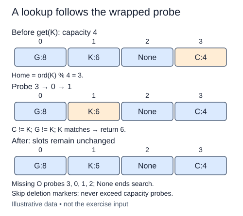

This lesson starts a fresh `ProbingTable`, not an incremental change to `HashTable`. Separate chaining stored a list at each bucket. Open addressing instead stores at most one `(key, value)` pair per slot. When a home slot is occupied by a different key, linear probing tries the next slot, wrapping at the end.

The constructor and put loop are supplied. First complete their shared `probe_slot` helper; then add the missing outcomes in get. Put becomes usable as soon as that helper works. Read its loop before editing. Its offsets run from zero through capacity minus one; adding each offset to the home index and taking the remainder visits every slot once. It updates equal keys, inserts into an available slot, and raises `OverflowError` when the fixed table has no reusable slot. It does not resize.

For a separate trace, a capacity-four table may place three keys with the same home index three at slots three, zero, and one. Looking up the third key must follow that wrapped sequence and compare the keys it encounters. A matching hash location alone is not a match.

An untouched slot contains `None`. Reaching it proves the key is absent because insertion would not have passed that slot. A full table has no such stopping point, so also stop after at most capacity probes. Raise `KeyError(key)` if missing. The supplied `_DELETED` object is a reserved marker for the next lesson: skip it rather than stop. Put already remembers the first marker but keeps searching for an existing equal key before reusing it; this prevents duplicate keys after deletion.

Under suitable hashing and a load safely below one, expected probe counts can be small. Clusters of neighboring occupied slots can grow, and worst-case lookup takes O(capacity) probes, plus hashing and equality costs. Unlike chaining, a fixed probing table can become completely full. This lesson makes that termination boundary explicit.

The probe wraps through physical slots; it does not scan from index zero by default. A successful lookup leaves every slot unchanged.

## Build it in small steps

First implement the wrapped index arithmetic in `probe_slot`. The supplied put and get loops use this helper for each offset. Then finish the two lookup outcomes: missing and found. The helper assumes a positive capacity and a valid home index.

## Your Tasks

1. Complete `probe_slot` to wrap a home index plus an offset into the slot range.
2. Report a missing key at an untouched slot or after a full unsuccessful probe cycle.
3. Return an equal live pair's value, continuing past collisions and tombstones.

Edit `main.py` one step at a time. Run uses the supplied probe; an unfinished field or return value may print a reminder. Submit checks the numbered steps in order, so you can see each completed step before finishing the next.
