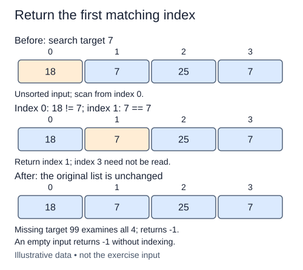

A tray list records items in arrival order, not sorted order. To locate an item, inspect each value from left to right. Without an ordering promise, a failed comparison gives you no reason to skip a later position.

The result is an index, not the value itself. Return the first index whose value equals the target. If the list contains duplicates, stop at the earliest match. If there is no match, return `-1`. An empty input therefore returns `-1` without reading any item.

For a separate trace, searching for `"hook"` in `["pin", "hook", "clip", "hook"]` examines pin, then hook, and returns one. The last hook never needs to be compared. Searching for cord examines all four values and returns minus one. This first-match policy differs from collecting every matching index, which cannot stop early.

Use an explicit loop, such as `enumerate(values)`, to keep the current index and value together. Do not call `list.index`, sort the input, or convert it to a set or dictionary. Those shortcuts either hide the scan you are learning or discard the original positions. The function must leave the input unchanged.

A match at the first position costs one equality check, so best-case work is O(1). Missing values and matches at the end need O(n) comparisons. Auxiliary space is O(1). These bounds assume each equality comparison has constant cost; comparing long strings or nested objects can add work.

Be careful when consuming the result: index zero is a successful answer even though it is false in a boolean condition. Compare against `-1` explicitly before indexing, because Python treats `values[-1]` as the last item rather than a missing-value marker.

Returning on the first equality gives the first-match policy without changing the input order.

## Build it in small steps

The left-to-right loop is supplied. First finish the exhausted-scan result, then add the early return for a match.

## Your Tasks

1. Return `-1` after the scan finishes without a match.
2. Return the first equal item's index from inside the scan.

Edit `main.py` one step at a time. Run uses the supplied probe; an unfinished field or return value may print a reminder. Submit checks the numbered steps in order, so you can see each completed step before finishing the next.
