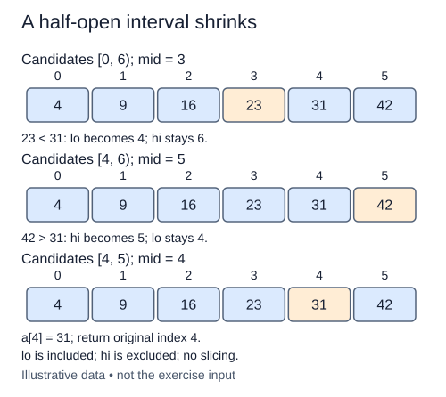

Binary search needs a stronger input promise than linear search: values are already sorted in nondecreasing order. Sorting inside the function would change positions and add substantial work, so the caller supplies that order. This lesson uses integer lists and an integer target; the function does not check or repair unsorted input.

Keep a half-open candidate interval `[lo, hi)`. It includes lo and excludes hi. Initially lo is zero and hi is `len(values)`. An empty interval has `lo == hi`, so there is no index to read. While lo is smaller than hi, choose `mid = lo + (hi - lo) // 2`; mid is inside the interval.

For a different trace, search for eleven in `[2, 6, 11, 15, 20]`. The first middle is index two, which matches. For a target of fourteen, the middle is too small: sorted order proves every position through mid is also too small. Set lo to `mid + 1`. If the middle is too large, set hi to mid, excluding that already-tested position and everything to its right.

On equality, return mid. With duplicates, any matching index is acceptable in this lesson; first and last occurrence are different contracts taught shortly. If the interval empties, return `-1`. The input remains unchanged, and an empty list needs no special element access.

Every unsuccessful iteration strictly reduces the interval. Using `lo = mid` can stall on a one-element interval; using `hi = mid - 1` mixes closed and half-open conventions and can skip a candidate. Maintain one convention throughout.

The loop needs O(log n) comparisons and O(1) extra space, assuming constant-time indexing and integer comparison. Do not use slicing, a linear membership scan, a built-in search, or sorting: the objective is to implement the halving process itself.

Each unequal midpoint is excluded from the next interval. The original indices stay fixed because the search does not slice the list.

## Build it in small steps

The initial bounds and an intentionally paused loop are supplied. Establish the empty result first. Then replace the pause with the halving algorithm; the second check includes missing values in nonempty lists and duplicate matches.

## Your Tasks

1. Return `-1` when the candidate interval is empty.
2. Replace the loop pause with midpoint comparison, strict interval updates, and an equal-index return.

Edit `main.py` one step at a time. Run uses the supplied probe; an unfinished field or return value may print a reminder. Submit checks the numbered steps in order, so you can see each completed step before finishing the next.
