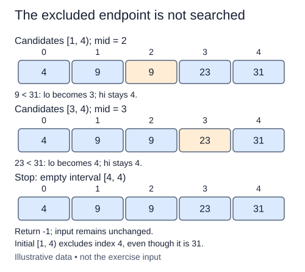

A caller may want to search one sorted region rather than the whole list. Add `binary_search_range(values, target, lo, hi)` while keeping the previous whole-list search available in the starter. The new function receives its initial bounds instead of always choosing zero and length.

The bounds are half-open: lo is allowed, hi is excluded. Require integers other than bool with `0 <= lo <= hi <= len(values)`. Invalid bounds raise `ValueError` before any element access. A valid empty interval, including `[len(values), len(values))`, simply returns `-1`.

For a separate example, `[3, 7, 7, 12, 18]` searched over `[2, 4)` exposes indices two and three only. A search for seven may return two, but never one even though one also holds seven. A search for eighteen must report missing because index four is excluded. Return original-list indices; slicing the list first would introduce offset bookkeeping and copy data.

The caller promises that the requested region is nondecreasing. Items outside it are irrelevant and must not be inspected. Maintain the same shrinking rule as before: exclude mid on inequality, retain only the half that could contain the target, and return any equal index inside the requested region. Duplicates outside the region do not affect the answer.

This is also a useful boundary test for the original binary-search reasoning. The invariant refers to the current interval, not automatically to the full list. Changing the bounds cannot justify a pre-scan of the excluded prefix or suffix.

For a region of r items, search takes O(log r) comparisons when r is positive and O(1) work when empty. Bounds validation is O(1), and auxiliary space stays O(1). No list slicing, built-in search, or sorting is needed.

A value can exist in the list yet be missing from the permitted region. Keep the caller’s original upper boundary exclusive.

## Build it in small steps

`validate_bounds` is a small input-contract helper. The search function calls it before any access. After the empty result works, replace the paused loop with the already-familiar interval reduction.

## Your Tasks

1. Complete `validate_bounds` with the half-open integer-bound rules.
2. Return `-1` for a valid empty search interval.
3. Replace the loop pause with a binary search confined to the supplied bounds.

Edit `main.py` one step at a time. Run uses the supplied probe; an unfinished field or return value may print a reminder. Submit checks the numbered steps in order, so you can see each completed step before finishing the next.
