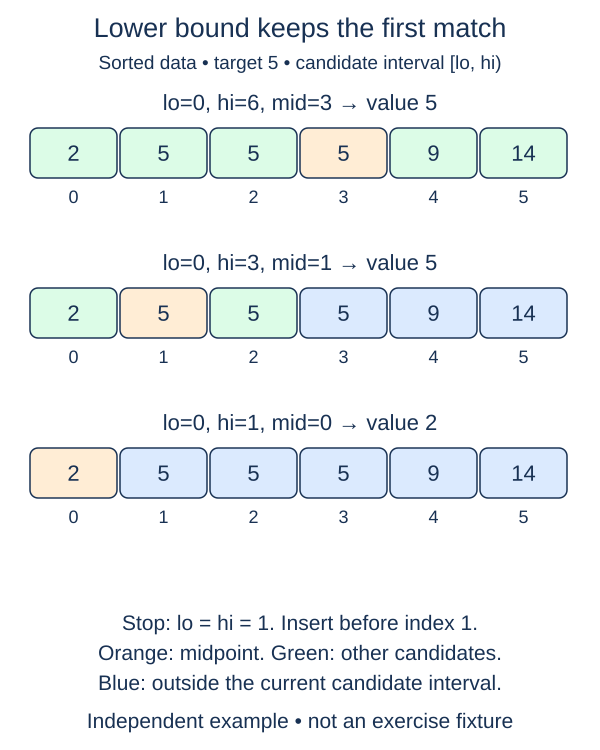

An ordinary binary search may stop at any duplicate. A lower bound asks a different question: where does the region of values at least as large as the target begin? That boundary is useful whether or not the target appears.

This is a fresh boundary-search function over a nondecreasing integer list. Return the smallest index p such that every value before p is less than target and every value from p onward is at least target. If all values are smaller, return `len(values)`. An empty list returns zero. Those are valid insertion positions, not `-1` missing markers.

For a different trace, `[1, 5, 5, 5, 9]` has lower bound one for target five, four for target seven, and five for target ten. A returned position may equal length, so check `p < len(values)` before reading `values[p]`. To determine membership, also check whether that value equals the target.

Use `[lo, hi)` as the unresolved interval. Values strictly before lo are already known to be too small; values at or after hi are already known to be large enough. If the middle value is smaller, move lo past mid. Otherwise move hi to mid. Equality belongs in the latter branch: mid might be the boundary, but an earlier equal value may exist. Do not return immediately on equality.

When lo and hi meet, their shared position is the partition boundary. The loop has no special duplicate-scanning phase, so a long run of equal values still takes O(log n) comparisons. Auxiliary space is O(1). Use indices and comparisons rather than a built-in boundary helper or a scan. The caller supplies sorted input; validating that order would itself cost O(n).

Equality keeps the search moving left toward the first qualifying position. Unlike any-match search, it does not return the first midpoint that equals the target.

## Build it in small steps

`lower_step` handles one decision and assumes valid bounds with lo < hi. It returns a pair of new bounds, leaving values untouched. The outer function repeats that shrinking step and handles empty input without calling the helper.

## Your Tasks

1. Complete `lower_step` to return the next half-open bounds for one nonempty interval.
2. Complete `lower_bound` to repeat that step until the bounds meet and return the boundary.

Edit `main.py` one step at a time. Run uses the supplied probe; an unfinished field or return value may print a reminder. Submit checks the numbered steps in order, so you can see each completed step before finishing the next.
