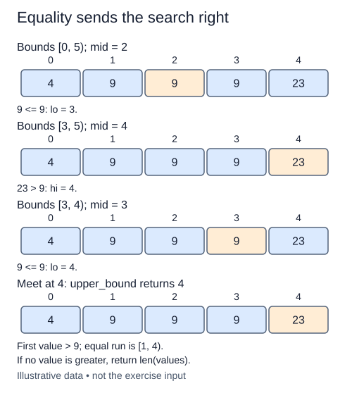

The lower bound marks where a target's equal values begin. The upper bound marks where values strictly greater than the target begin. The completed lower_bound function is supplied; add upper_bound beside it.

For a separate list `[2, 6, 6, 6, 10]`, target six has lower bound one and upper bound four. Its duplicate range is the half-open interval `[1, 4)`, and its occurrence count is the difference between the two boundaries. For an absent target eight, both boundaries are four. Equal boundaries describe an empty range rather than a failure.

Maintain the same half-open unresolved interval as before, but change which side accepts equality. Values before lo must be less than or equal to the target, and values from hi onward must be strictly greater. If the middle value is less than or equal to target, move lo past mid. Otherwise move hi to mid. An equality is evidence to continue right, not a reason to return that position.

Return the meeting point. An empty input returns zero; if no value is greater, return length. Do not dereference that end position. Like lower bound, upper bound does not mutate the list and assumes it is already nondecreasing.

The comparison change is small, but the contract is different. Test an all-equal list, an absent value between two groups, and targets on either side of the entire list. A function copied from lower bound without changing the equality branch will often look correct on distinct-value examples.

Upper bound takes O(log n) comparisons and O(1) auxiliary space. Finding both boundaries has the same asymptotic cost. Counting duplicates by walking from the first match could take O(n) for a long equal run, so keep both boundary searches logarithmic.

Equality moves lo past the midpoint here, the opposite choice from lower bound. The equal run occupies [1, 4).

## Build it in small steps

The supplied lower-bound functions remain unchanged. `upper_step` assumes a valid nonempty interval and handles one comparison; `upper_bound` repeats it until the bounds meet.

## Your Tasks

1. Complete `upper_step` to move equality into the left partition when returning new bounds.
2. Complete `upper_bound` to repeat the step and return the first strictly-greater position.

Edit `main.py` one step at a time. Run uses the supplied probe; an unfinished field or return value may print a reminder. Submit checks the numbered steps in order, so you can see each completed step before finishing the next.
