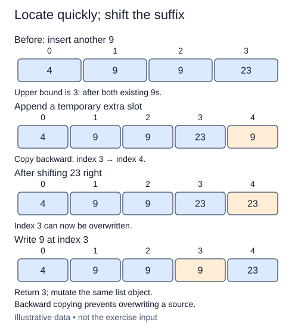

A sorted list supports fast position searches, but inserting at that position still requires moving references. This lesson connects the two costs instead of treating binary search as a guarantee of a cheap update.

Both boundary helpers are supplied. The insertion policy is to place a new value after all existing equal values, so use upper_bound to choose the position. Return that original insertion position and modify the given list object in place. An empty list gains one item at position zero.

For a separate example, inserting six into `[1, 6, 6, 9]` chooses position three. The nine must move right one place before the new six is written. Inserting zero moves every existing item; inserting twelve needs no shift. Duplicate values make the after-equals policy observable through the returned index even when the final numeric list looks the same under either policy.

Append a temporary extra slot first. The shift helper uses zero as a placeholder; the insertion function will overwrite the chosen gap with the target. Starting at the new final index, copy each predecessor one place right until the insertion position is free. Move from right to left. A left-to-right shift would overwrite a source value before its next copy and could repeat the same item across the suffix.

Finally write target at the chosen position. Do not call list.insert, sort, or a built-in search; the task is to connect your boundary helper to the movement it requires. Keep the original list identity so callers holding that list observe the change.

Boundary search uses O(log n) comparisons. The shift moves up to n references, so worst-case insertion time is O(n). Appending has amortized O(1) growth cost, but a particular append can allocate and copy O(n) storage. The function's index bookkeeping uses O(1) auxiliary space, while the list itself grows by one element.

The figure uses 9 in the temporary extra slot; your shift helper uses zero. That placeholder is overwritten either way. The important order is to shift the suffix backward before filling the gap.

## Build it in small steps

`shift_right` assumes 0 <= position <= len(values). It appends a temporary zero and moves the suffix backward; the chosen position is a temporary gap whose old value does not matter. `insert_sorted` fills that gap immediately. Zero is not a special input restriction.

## Your Tasks

1. Complete `shift_right` to add a temporary slot and move the suffix right, copying backward.
2. Complete `insert_sorted` to find the upper bound, call the shift helper, write target, and return its position.

Edit `main.py` one step at a time. Run uses the supplied probe; an unfinished field or return value may print a reminder. Submit checks the numbered steps in order, so you can see each completed step before finishing the next.
