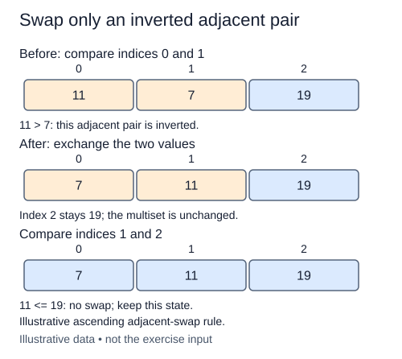

A sorting algorithm needs a rule for changing order without losing values. Start with one adjacent pair: exchange the two references only when the right value belongs before the left. This small operation will become the building block for bubble sort.

## Work through the idea

For a tray labelled `[6, 4, 9]`, inspect positions zero and one. The pair is out of order, so the tray becomes `[4, 6, 9]`; position two is untouched. Looking at positions one and two next would make no change.

Use the index to identify both slots before writing either slot. Python's simultaneous assignment evaluates the right side first, so it can exchange references without overwriting the value you still need. A temporary variable is another valid way to preserve that value.

The comparison must be strict. Equal values are already in acceptable order, and exchanging equal-key records could reverse their arrival order. This is the first piece of a stable sorting rule. Return a boolean that describes whether an exchange happened, rather than returning the list itself. Later, a whole pass will combine these booleans to notice that no more work is needed.

## Contract and cost

`swap_adjacent(values, index)` mutates the supplied list and returns `True` only for an exchange. Values support `<`; duplicates are allowed. Reject a negative index or a pair extending beyond the list with `IndexError`, before any mutation. In particular, empty and singleton lists have no valid pair. Do not sort the rest of the list or make a replacement list.

One valid call performs one comparison and at most one exchange: O(1) time and O(1) auxiliary space under constant-cost comparisons. The objects themselves are not copied.

The annotations `list[Any]` and `-> bool` describe a list of comparable values and a boolean result. `Any` keeps these helpers flexible, but values must still support the documented comparisons. Type hints do not check inputs at runtime.

## Your Tasks

1. In `swap_adjacent`, reject an index that does not identify a complete adjacent pair.
2. In `swap_adjacent`, exchange a descending pair and return whether it changed.

Edit `main.py`, then press **Run** to inspect the supplied probe and **Submit** to check each task. Complete the numbered changes in order. The supplied code keeps earlier operations available; you do not need to copy anything from another lesson.
