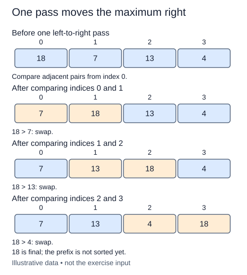

A single repaired pair does not sort a shelf. A left-to-right pass carries a large value across its smaller neighbors. You will build that pass using the completed `swap_adjacent` helper, which is already in this starter.

## Work through the idea

Trace `[8, 3, 6, 2]`. The first exchange gives `[3, 8, 6, 2]`; the next gives `[3, 6, 8, 2]`; the last gives `[3, 6, 2, 8]`. The maximum reaches the right edge, although the earlier values still need work.

`stop` is an exclusive boundary. Only positions before it belong to this pass. Comparing position `stop - 1` to position `stop` would cross that boundary, so the last pair begins at `stop - 2`. For boundaries zero and one there are no pairs to inspect.

Keep a flag that starts false and becomes true whenever the helper exchanges a pair. Once true, it stays true even if the final comparison needs no exchange. Do not write a short-circuit expression that skips calling the helper after the flag becomes true. Every adjacent pair in the active prefix must be considered exactly once, in left-to-right order. The already completed suffix is deliberately outside this operation.

## Contract and cost

Mutate only `values[:stop]`, without constructing a slice to sort. Return whether any pair changed. Raise `ValueError` for `stop` outside `0..len(values)` before writing. Equal values keep their relative order because the supplied helper exchanges only strict inversions. This stage adds one function; leave the previous helper intact.

A pass makes max(0, stop - 1) comparisons, so it costs O(stop) time and O(1) auxiliary space. It is not a complete sort.

## Your Tasks

1. In `bubble_pass`, reject an exclusive stop outside the list boundaries.
2. In `bubble_pass`, scan every active pair and return whether any exchange occurred.

Edit `main.py`, then press **Run** to inspect the supplied probe and **Submit** to check each task. Complete the numbered changes in order. The supplied code keeps earlier operations available; you do not need to copy anything from another lesson.
