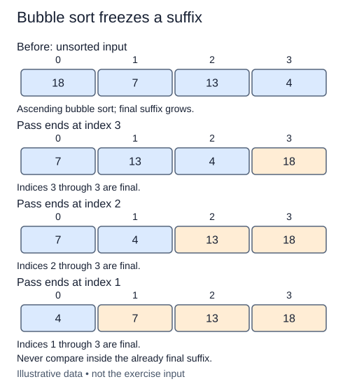

Finish bubble sort by repeating the pass you just built. Each pass settles one more value at the right edge. The starter contains both completed helpers; your new function decides which prefix still needs attention.

## Work through the idea

After one pass over `[5, 1, 4, 2]`, the maximum is at the end. The next pass can stop before that position. A later pass can stop one position earlier again. This shrinking boundary is the invariant: the suffix beyond it is sorted and already belongs there.

Start with the entire list as the active prefix. Call `bubble_pass`, then reduce the exclusive boundary for the next round. You do not need a pass over a prefix of length one. A pass returning false is useful evidence: every neighboring pair in the active prefix is ordered, and the settled suffix is already correct. You can stop immediately.

Be careful about the difference between no exchange in one pair and no exchanges in an entire pass. Only the latter justifies stopping. Preserve the helper's strict comparison so duplicate keys keep their original order. This algorithm uses local exchanges rather than selecting a minimum or handing the work to a library sorting function.

## Contract and cost

`bubble_sort(values)` sorts ascending in place and returns that same list object. Empty lists and singletons are valid. Duplicates remain present, and equal-key items remain in arrival order. Use the supplied `bubble_pass` with descending active boundaries; stop after a no-change pass. No caller list is replaced.

Worst-case and average time are O(n²); an already sorted list takes O(n) comparisons with early stopping. Auxiliary space is O(1). Stable adjacent swaps do not make the algorithm fast for large reversed inputs.

## Your Tasks

1. In `bubble_sort`, run a shrinking pass for each boundary in `pass_stops`.

Edit `main.py`, then press **Run** to inspect the supplied probe and **Submit** to check each task. Complete the numbered changes in order. The supplied code keeps earlier operations available; you do not need to copy anything from another lesson.
