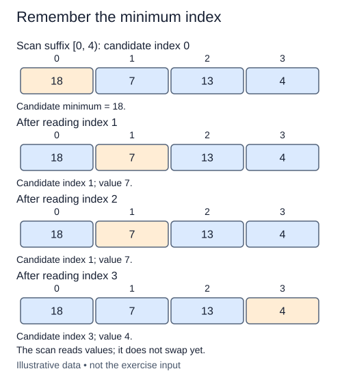

Selection sort asks a different question from bubble sort: which remaining value belongs in the next output position? Before moving anything, write a search that returns the location of the smallest value in a suffix.

## Work through the idea

For `[1, 7, 3, 3, 9]` with `start = 1`, the candidates are the final four values. Begin by treating position one as the best candidate. Position two improves that candidate; position three ties it and should not replace it. The answer is position two, not the value three.

The invariant is local to the scan: after inspecting a position, `best` refers to the first minimum among the suffix positions examined so far. Each new comparison either improves the candidate or leaves it alone. Initialize from the actual suffix instead of a made-up large number; a sentinel number could fail for larger values or nonnumeric comparable objects.

This operation is read-only. Returning an index lets the next lesson choose when to exchange values. Notice why an empty suffix needs a defined error: there is no valid index to return. A suffix containing one value needs no comparisons, but its starting index is still a valid answer.

## Contract and cost

Return the absolute list index of the first minimum in `values[start:]`. Accept mutually comparable values, including duplicates. Raise `IndexError` when `start` is negative or outside the list. Do not mutate the list, slice it to search, or call `min`, `sorted`, or `sort`; write the scan yourself. This is a fresh helper for selection sort, not an extension of the bubble-sort implementation.

Inspecting a suffix of length m costs O(m) time and O(1) auxiliary space. Returning an index avoids allocating a copied suffix.

## Your Tasks

1. In `minimum_index`, reject an empty or invalid suffix before reading a candidate.
2. In `minimum_index`, scan the suffix and return the first minimum position without mutation.

Edit `main.py`, then press **Run** to inspect the supplied probe and **Submit** to check each task. Complete the numbered changes in order. The supplied code keeps earlier operations available; you do not need to copy anything from another lesson.
