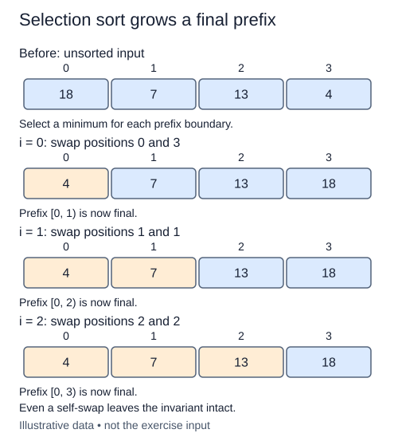

Use the minimum-index search to fill the sorted prefix one position at a time. Selection sort makes a small number of exchanges, but finding the next value still requires scanning the remaining suffix.

## Work through the idea

Imagine `[4, 2, 3, 1]`. The first search finds the one at the far end. Exchanging it with the first value creates `[1, 2, 3, 4]`. Even though this example is now sorted, the ordinary algorithm still searches each remaining suffix; it does not have bubble sort's no-change stopping rule.

Before iteration `start`, all positions below `start` contain the smallest values in their final order. Search the suffix beginning at `start`, then exchange its minimum with the value currently occupying that slot. Advance `start` to grow the prefix. The last position needs no separate search because only one candidate remains.

A long-distance exchange is different from the adjacent exchanges you used earlier. Suppose two records with key four arrive as A then B, followed by a record with key one. Swapping the one with A can leave B before A. Choosing the first minimum does not prevent this reversal. Selection sort in this form is therefore not stable.

## Contract and cost

Sort `values` ascending in place and return the identical list. Call the supplied `minimum_index` once for each unfinished position except the final singleton suffix. Preserve all duplicates, but do not promise their relative record order. Empty and singleton lists are unchanged. Keep the completed helper; only the new function is unfinished.

There are n(n - 1)/2 comparisons in this implementation, so time is O(n²) even for sorted input. It uses O(n) exchanges and O(1) auxiliary space.

## Your Tasks

1. In `selection_sort`, place each remaining suffix minimum into the next destination.

Edit `main.py`, then press **Run** to inspect the supplied probe and **Submit** to check each task. Complete the numbered changes in order. The supplied code keeps earlier operations available; you do not need to copy anything from another lesson.
