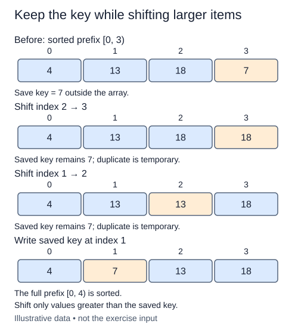

Insertion sort grows a sorted prefix without searching for the smallest remaining value. It takes the next item as given and makes room for it in the prefix. Your task is one insertion step, not the complete sort.

## Work through the idea

Consider `[2, 5, 9, 4, 7]` at index three. The prefix `[2, 5, 9]` is already sorted. Save the four before changing any slots. Shift nine one place right, then shift five. Two is not larger than four, so stop and put the saved item into the gap. The final seven is outside this step and remains untouched.

A cursor marks the current gap. While the cursor is positive, the preceding slot is safe to inspect. Move that predecessor right only if it is strictly greater than the saved item. Check the boundary before indexing: Python's negative indices are legal, but reading the last element here would be a logic error.

During shifting, one reference appears in two slots temporarily. That is expected; the saved reference is what makes it possible to restore the full multiset at the end. Equal-key predecessors should not move. Leaving them before the new item is what gives insertion sort its stability.

## Build it in checkpoints

The shifting phase is now a separate `shift_larger` helper. First implement that helper: its cursor begins at the insertion index, copies each strictly larger predecessor one position right, and returns the final gap. The caller has already saved the item before invoking it. A temporary duplicate during shifting is expected. The final task fills the gap, which restores the saved item and the original multiset.

## Contract and cost

`insert_at(values, index)` assumes the prefix before `index` is sorted. Insert that indexed item into the prefix, mutate the same list, and return it. Leave the suffix after `index` unchanged. Reject invalid indices with `IndexError` before mutation. Index zero is valid. Write the shifting loop rather than using list `insert`, `pop`, or a library sorter. This lesson begins a fresh insertion-sort helper.

At index i the step takes O(i) time in the worst case, O(1) when the item already fits, and O(1) auxiliary space. It does not copy the prefix.

## Your Tasks

1. In `shift_larger`, shift larger predecessors right and return the final gap index.
2. In `insert_at`, reject an invalid insertion position before mutation.
3. In `insert_at`, fill the returned gap with the saved item and return the same list.

Edit `main.py`, then press **Run** to inspect the supplied probe and **Submit** to check each task. Complete the numbered changes in order. The supplied code keeps earlier operations available; you do not need to copy anything from another lesson.
