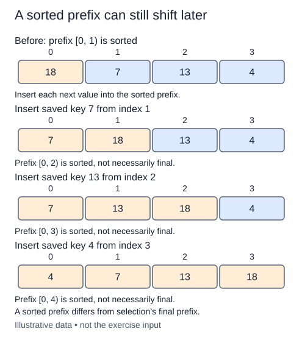

The insertion step is complete. Now arrange those steps so each one receives the sorted prefix it expects. This is the full insertion-sort algorithm, built from the helper already present in the starter.

## Work through the idea

The first item alone is a sorted prefix. Insert the item at position one into that prefix, then the item at position two, and continue to the end. For `[6, 2, 5, 1]`, the first insertion produces `[2, 6, 5, 1]`. The next produces `[2, 5, 6, 1]`. Only then does the last item join the sorted prefix.

The increasing index is important. If you start from the far end, the helper's assumption about an already sorted prefix is false. At the beginning of each iteration, all items before the index are sorted; at its end, the item at the index has joined them. This is an example of using one function's postcondition to establish the next call's precondition.

Do not remove an item from the list in the outer loop. The helper already saves and shifts it without changing list length. Your outer loop only chooses the next index. Since every step moves strictly larger predecessors, records with equal keys retain their input order throughout the whole algorithm.

## Contract and cost

Sort ascending in place and return the same list. Use the supplied `insert_at` for indices one through the last index. Empty and singleton inputs need no helper calls. Keep duplicates and preserve their relative order. No copying into a new result and no built-in sorting are needed.

Worst-case and average time are O(n²), but sorted or nearly sorted data needs fewer shifts; sorted input takes O(n) time. Auxiliary space remains O(1). These bounds assume constant-cost comparisons and assignments.

## Your Tasks

1. In `insertion_sort`, extend the sorted prefix by calling `insert_at` at each next index.

Edit `main.py`, then press **Run** to inspect the supplied probe and **Submit** to check each task. Complete the numbered changes in order. The supplied code keeps earlier operations available; you do not need to copy anything from another lesson.
