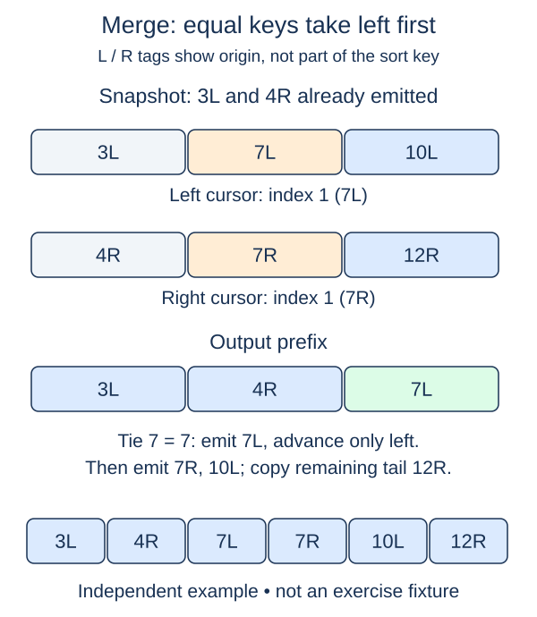

Two already sorted lists can be combined without searching the entire remainder for each next item. Build a merge operation that compares only the two current fronts. The result will be the combining step for merge sort.

## Work through the idea

With `[2, 7]` and `[3, 6, 9]`, compare two with three and copy two into the result. Advance only the left cursor. The next comparison is seven with three, so advance the right cursor instead. Each choice consumes exactly one input item.

The invariant is that the result contains the smallest consumed items in order, while each cursor points to the first unused item of its run. Once one run ends, no more comparisons are necessary: the other run's remainder is already ordered and can be copied in sequence. Check both cursor bounds before reading their items.

When keys tie, take the left item first. In the next lesson, the left run represents an earlier portion of the original input, so this rule preserves the arrival order of equal keys. Using `right[j] < left[i]` makes the tie rule explicit without requiring a separate equality test or a `<=` method on custom records.

## Build it in checkpoints

Build this merge in two observable stages. `merge_fronts(left, right)` returns `(prefix, left_cursor, right_cursor)` as soon as either run ends. That helper owns the comparison phase and its left-first tie rule. `merge_runs` is supplied with the call and tuple unpacking; your last change appends the remaining suffixes. The returned cursor positions tell you exactly which items are still unconsumed.

## Contract and cost

`merge_runs(left, right)` assumes both lists are sorted ascending. Return a new list, including for empty inputs, and leave both inputs unchanged. Preserve duplicates and choose left before right on ties. Copy references rather than cloning contained objects. Use cursors, not repeated `pop(0)`, which would shift the remaining list on every removal. This helper begins the merge-sort implementation.

For m and n input items, merging takes O(m + n) time and O(m + n) result space. Cursor state uses O(1) extra space beyond that result.

## Your Tasks

1. In `merge_fronts`, merge current fronts until one run ends; return the prefix and both cursors.
2. In `merge_runs`, append both unconsumed suffixes and return the completed merge.

Edit `main.py`, then press **Run** to inspect the supplied probe and **Submit** to check each task. Complete the numbered changes in order. The supplied code keeps earlier operations available; you do not need to copy anything from another lesson.
