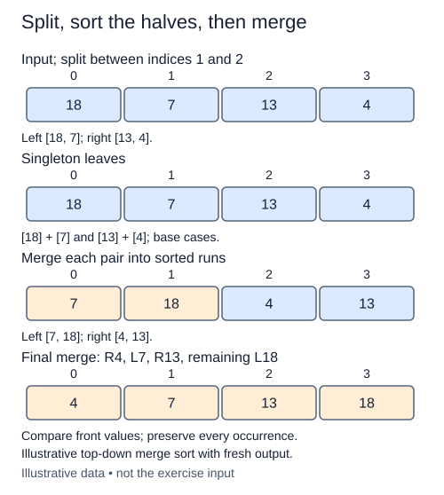

Merge needs sorted inputs. Merge sort creates them by repeatedly splitting a list until every piece has at most one item, then merging the pieces on the way back out of recursion.

## Work through the idea

Split `[9, 4, 7, 2]` into `[9, 4]` and `[7, 2]`. Each pair splits into singleton runs. Those singletons merge into `[4, 9]` and `[2, 7]`; one final merge produces the sorted result. The small pieces are sorted before their parent call tries to combine them.

Write the base case before the recursive calls. A list of length zero or one is already sorted, but the contract still asks for a new list. For larger inputs, a middle index divides the values into two strictly smaller lists. Sort both halves recursively, then pass the returned runs to the completed merge helper.

It is tempting to call the helper on the original halves immediately. That fails because splitting alone does not sort them. The recursion establishes the helper's precondition. Keep the left half as the first merge argument so the left-first tie rule carries the original order of equal keys all the way to the final result.

## Contract and cost

`merge_sort(values)` returns a new sorted list without changing `values`. Preserve duplicates and stability. Use recursive halving and the supplied `merge_runs`, not another sorting algorithm. Slices here are intentional shallow copies. Contained record objects retain their identities. Keep examples small enough for ordinary Python recursion.

Time is O(n log n). This slicing implementation has O(n) peak auxiliary list storage plus O(log n) recursive frames; across the whole run it allocates O(n log n) references in total. Peak space and cumulative allocation are different quantities.

## Your Tasks

1. In `merge_sort`, return a fresh copy for inputs with fewer than two items.
2. In `merge_sort`, recursively sort both halves and combine them with `merge_runs`.

Edit `main.py`, then press **Run** to inspect the supplied probe and **Submit** to check each task. Complete the numbered changes in order. The supplied code keeps earlier operations available; you do not need to copy anything from another lesson.
