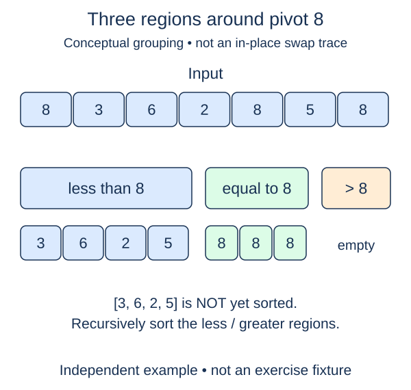

Quicksort divides work around a pivot rather than merging sorted halves. First implement one partition: place the final item of an interval into its correct position relative to that interval's other values.

## Work through the idea

In `[7, 2, 6, 4]`, use the final four as pivot. A boundary marks where the next value smaller than four should go. Seven stays on the large side. Two exchanges into the boundary slot, and the boundary advances. Six stays on the large side. Finally exchange the pivot into the boundary slot.

During the scan, positions before the boundary are strictly smaller than the pivot. Positions from the boundary to the scan cursor are already inspected but not smaller. Positions beyond the cursor, excluding the saved pivot slot, are still unknown. This three-region description helps you check an exchange without assuming either region is internally sorted.

Scan only through the position before `high`. Keep the pivot at `high` until that scan is finished, then move it once into the boundary. Return its index. Values equal to the pivot belong on the not-smaller side during this version's scan; duplicates are retained but can lead to very uneven recursive work later.

## Build it in checkpoints

The comparison scan has its own helper, `scan_partition`. It receives already validated bounds and leaves the pivot in the final slot, returning only the boundary. After you can check that intermediate state, complete the pivot-placement step in `partition`. The caller's saved bounds and supplied helper call keep the two changes independent.

## Contract and cost

`low` and `high` are inclusive valid indices with `low <= high`. Raise `IndexError` for an invalid interval before mutation. Partition only that interval; positions outside it remain unchanged. Return the pivot's final index, with strictly smaller items to its left and items greater than or equal to it on its right. Use this last-element, left-to-right boundary scheme. It is not stable.

An interval of length m takes O(m) time and O(1) auxiliary space. Partitioning does not sort the two resulting regions; the next lesson introduces recursion using an explicitly different, three-way partition.

This figure previews conceptual three-way grouping, not the in-place exchange sequence you implement here. This lesson uses a last-element pivot and two regions; the next lesson builds the pictured allocating variation.

## Your Tasks

1. In `scan_partition`, scan non-pivot items into the smaller region and return its boundary.
2. In `partition`, reject an invalid inclusive interval before mutation.
3. In `partition`, exchange the pivot into the returned boundary and return that index.

Edit `main.py`, then press **Run** to inspect the supplied probe and **Submit** to check each task. Complete the numbered changes in order. The supplied code keeps earlier operations available; you do not need to copy anything from another lesson.
