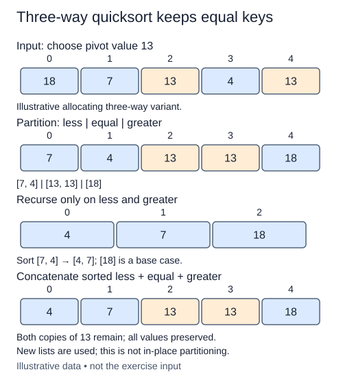

Build a copy-returning three-way quicksort. Group equal values together so they leave the recursive work at once, while the smaller and greater groups are sorted separately.

## Work through the idea

The preceding lesson implemented an in-place two-region partition. This lesson deliberately starts an allocating variation with three lists. Both approaches use a pivot to divide work, but their interfaces, duplicate handling, and space costs differ. Keep the earlier partition helper available as a separate operation; this controller does not call it.

Choose the value at the middle position as the pivot. This is not a median calculation and does not guarantee equal-sized groups. `split_three` walks the input in order and appends each occurrence to a less, equal, or greater list. Compare with < in both directions; if neither side is smaller, these supported comparable values belong to the equal group.

For `[10, 3, 6, 2, 6]`, the middle pivot is six. The groups are `[3, 2]`, `[6, 6]`, and `[10]`. Only the first and last groups need recursion. The equal group is already ordered and preserves both copies of six.

An empty or singleton input returns a fresh copy. For larger inputs, recursively sort the less and greater lists, then concatenate sorted-less, equal, and sorted-greater. Concatenating the unsorted groups would merely partition, not sort. Every nonempty split puts at least the pivot occurrence into the equal group, so recursive calls receive fewer items.

The source does not mutate the input or use the built-in sorter. New lists make the intermediate groups easier to inspect, but they are real allocations. All-equal input finishes after one grouping pass rather than recursing through a long chain of equal pivots.

## Build it in checkpoints

This lesson deliberately starts an allocating three-way quicksort variation; it does not change the completed in-place `partition` helper. `split_three` chooses the middle-position value (not a calculated median) and creates less, equal, and greater lists. Append every input occurrence to exactly one group. Recursing only on the two unequal groups removes all pivot-equal items from further work at once. Every nonempty input contributes at least its chosen pivot to the equal group, so both recursive problems are smaller.

## Contract and cost

Return a fresh ascending list, leaving the input unchanged and preserving duplicate occurrences. Use the allocating three-way split with a middle-position pivot. The earlier in-place partition remains a separate completed helper, not this function’s implementation.

Balanced partitions give O(n log n) time and O(log n) recursion depth. Repeatedly unbalanced partitions can still give O(n²) time and O(n) depth. This simple version retains partition lists in active frames: peak auxiliary storage is O(n) for balanced splits but can reach O(n²) for a degenerate chain. It is not an in-place algorithm.

## Your Tasks

1. In `split_three`, separate a nonempty input into less, equal, and greater groups without mutation.
2. In `quicksort`, return a fresh copy for the recursive base case.
3. In `quicksort`, recursively sort the smaller and greater groups, then concatenate around the equal group.

Edit `main.py`, then press **Run** to inspect the supplied probe and **Submit** to check each task. Complete the numbered changes in order. The supplied code keeps earlier operations available; you do not need to copy anything from another lesson.
