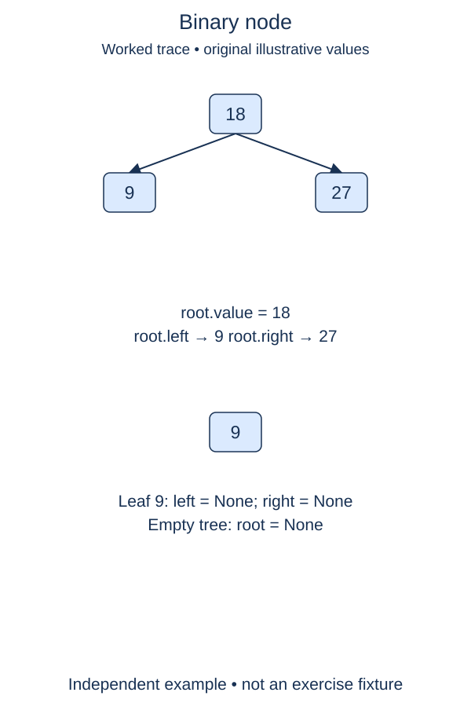

A binary tree represents a branching relationship. Each node stores one value and at most two child references, called `left` and `right`. Begin with the node constructor; traversal and search will build on this representation.

## Work through the idea

A small tree might have root value eleven, a left child holding four, and a right child holding sixteen. The root is one object, and its children are two other objects. The references describe the shape; list positions do not.

A missing child is `None`. A node with no children is a leaf. A path follows child links from one node to another, and a subtree consists of a node with everything below it. The root of an empty tree is also represented by `None`, not by a special node whose value is missing.

The constructor should keep the exact child objects it receives. Copying their values into new nodes would lose their own child links and change identity. Default child arguments can safely be `None` because that value is immutable; do not use shared mutable child containers. Make sure the left and right attributes exist on every instance, even a leaf.

For these exercises, a proper tree has no cycles and no child shared between two parents. The constructor stores links but does not validate that global rule. Ordinary binary trees also have no ordering rule: a left child may hold a larger value. A binary search tree will add a stricter contract later.

## Contract and cost

Complete `Node(value, left=None, right=None)` for integer-valued examples. Store all three arguments as attributes with the same names. `Node | None` in a type hint means either a node reference or `None`; future annotations let methods mention the class while it is being defined. Hints document expectations rather than checking them at runtime.

Creating one node takes O(1) time and O(1) space, excluding already existing children. A tree of n distinct nodes occupies O(n) node storage.

## Your Tasks

1. In `Node.__init__`, store the supplied integer value on the new node.
2. In `Node.__init__`, store the exact left and right child references, including missing children.

Edit `main.py`, then press **Run** to inspect the supplied probe and **Submit** to check each task. Complete the numbered changes in order. The supplied code keeps earlier operations available; you do not need to copy anything from another lesson.
