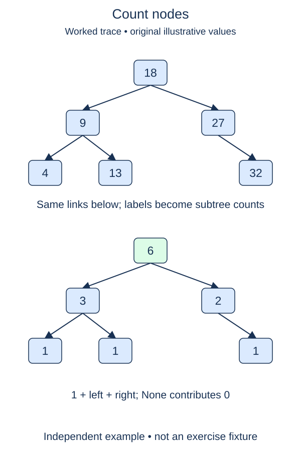

Count the nodes in a tree without flattening it into a list. The completed `Node` constructor stays in the starter. Your function will turn the shape of a tree into two smaller versions of the same counting problem.

## Work through the idea

An empty subtree contributes zero. A real node contributes one for itself, plus the count of its left subtree and the count of its right subtree. For a root with one leaf on each side, the two recursive calls each return one, so the root's answer is three.

Start by testing whether the argument is `None`. Only a real node has `.left` and `.right` attributes. Once that base case is handled, ask the same function for both child counts and combine their returned numbers. You are counting nodes, not summing their stored values; values such as zero, negative numbers, or duplicates must not alter the count.

Each recursive call has its own local argument. Returning from a leaf resumes the parent that was waiting for that count. You do not need a global counter or a mutable default argument. A function that returns its subtotal is easier to call repeatedly because one call leaves no state behind for the next.

This reasoning relies on proper trees. A cycle would prevent recursion from reaching a missing child, while a shared child would be visited once per path rather than once per distinct object. Those shapes are outside this lesson's input contract.

## Contract and cost

Return an integer count; return zero for `None`. Do not change values or child links. Use recursion on the two subtrees. The starter carries the completed node definition, and the supplied probe builds its own small tree. Duplicate values represent distinct nodes and must each be counted.

Time is O(n), because each node is visited once. Recursive stack space is O(h), where h is tree height: O(log n) for a balanced shape but O(n) for a chain. Python keeps those frames; it does not eliminate them.

## Your Tasks

1. In `count_nodes`, return zero for a missing subtree.
2. In `count_nodes`, combine both recursive child counts with the current node.

Edit `main.py`, then press **Run** to inspect the supplied probe and **Submit** to check each task. Complete the numbered changes in order. The supplied code keeps earlier operations available; you do not need to copy anything from another lesson.
