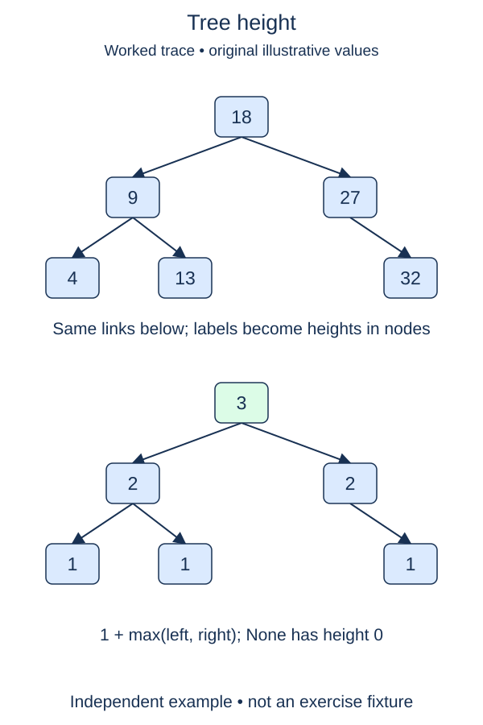

Two trees with the same number of nodes can have very different longest paths. Height measures that difference. It will explain why a search tree can be fast when compact and slow when it becomes a chain.

## Work through the idea

We measure height in nodes: a leaf has height one, and an empty tree has height zero. A root above one leaf has height two because the longest downward path contains two nodes. Other books and programs sometimes count edges instead; keep one convention throughout a calculation.

Ask for the height of each child subtree, choose the larger answer, then add one for the current node. If the left subtree has height three and the right subtree has height one, the root has height four. Adding both heights would combine two different downward paths; height follows only the longest one.

Start with the missing-subtree case before reading child attributes. A leaf then needs no special branch: both child calls return zero, and the same recurrence yields one. For a chain, every new node adds one to the height. A more branching shape can contain the same number of nodes with a smaller height.

Do not confuse height with depth. Depth usually counts edges from the overall root down to a particular node. This function receives a subtree root and measures the longest path below it using the stated node-count convention. It does not need to know where that subtree belongs in a larger tree.

The earlier counting function remains available, but you cannot calculate height from node count alone. Inspect the child links recursively and return a subtotal instead of maintaining a global maximum. That keeps repeated calls independent and avoids accidentally borrowing a result from a previous tree.

## Contract and cost

Return 0 for None, 1 for a leaf, and the maximum number of nodes on a downward path otherwise. Preserve all node values and links. The ordinary max function on two numbers is appropriate. Inputs are finite proper trees without cycles or shared children.

The function visits all n nodes, so time is O(n), not O(h). Recursive frames use O(h) space for a nonempty tree. Height is n for a chain, and a BST is not automatically balanced.

## Your Tasks

1. In `height`, give a missing subtree height zero.
2. In `height`, return one plus the larger recursive child height.

Edit `main.py`, then press **Run** to inspect the supplied probe and **Submit** to check each task. Complete the numbered changes in order. The supplied code keeps earlier operations available; you do not need to copy anything from another lesson.
