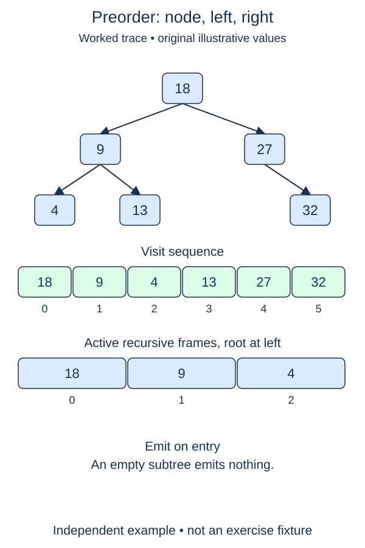

Write a preorder traversal that returns the values of a tree in a specific visiting order. The earlier node and traversal helpers remain completed; the new visitor and its public result wrapper are your tasks.

## Work through the idea

Preorder records a node before its children. With root ten, left child four, and right child fifteen, the result begins ten, then four, then fifteen. If four has children, finish that whole subtree before moving to fifteen. This is depth-first traversal: follow a branch before returning to a sibling.

Use a result list owned by the public function and a separate visitor helper. The visitor returns immediately for `None`; otherwise it appends the current value, visits the left subtree, and visits the right subtree. Those three actions describe the order, but the recursion handles arbitrarily nested branches. Append to the same result rather than creating and concatenating a new list at every node.

The name tells you where the node's own work happens: pre means before the recursive children. A preorder list can describe the order in which you encounter containers before their contents. Values alone do not uniquely reconstruct an arbitrary tree, however; missing-child markers or more information would be needed.

## Build it in checkpoints

The recursive work lives in `visit_preorder(node, result)`. A supplied empty-node guard ends missing branches. Append into the list passed by the caller; do not clear it or replace it. The helper can therefore be checked with an existing prefix before the public `preorder` function is complete. The public function's separate responsibility is to own a fresh result list for each call, invoke the visitor, and return that list.

## Contract and cost

Return a new list on every call, including for `None`. Preserve duplicate values and all child identities. Visit each node once in root, then left, then right order. This is a proper binary tree, not necessarily a search tree. Do not sort values, mutate links, or use a persistent result list shared between calls.

With one shared append-only result, time is O(n). The output uses O(n) space and recursion uses O(h) additional stack space. Concatenating separate subtree lists at every level can instead cause O(n²) copying on a chain; use the supplied empty function body to build one accumulator.

## Your Tasks

1. In `visit_preorder`, visit this node and its two subtrees in preorder order.
2. In `preorder`, return a fresh result list populated by the supplied visitor call.

Edit `main.py`, then press **Run** to inspect the supplied probe and **Submit** to check each task. Complete the numbered changes in order. The supplied code keeps earlier operations available; you do not need to copy anything from another lesson.
