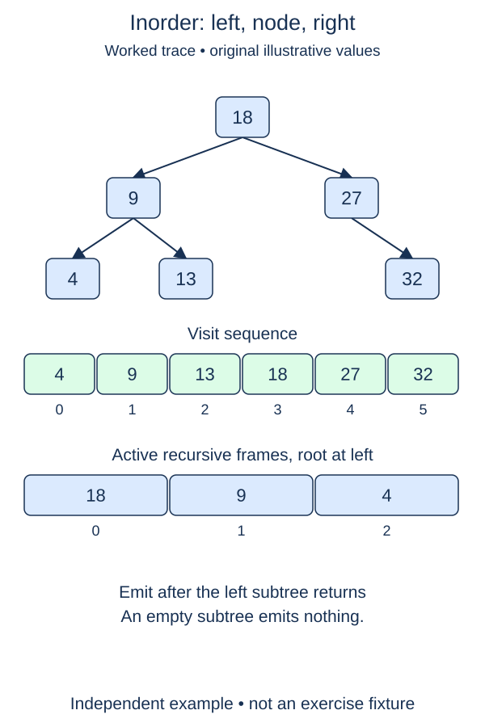

Write an inorder traversal that returns the values of a tree in a specific visiting order. The earlier node and traversal helpers remain completed; the new visitor and its public result wrapper are your tasks.

## Work through the idea

Inorder places the current node between its left and right subtrees. For a root ten with left child four and right child fifteen, the output is four, ten, fifteen. If the left child itself has a left descendant, that descendant appears before four.

Use the same visitor shape as preorder, but move the append between the two recursive calls. The recursive call on the left must finish completely before appending the current value. Then visit the right subtree. A shared result list collects each value once without repeated concatenation.

For an ordinary binary tree this order is structural, not necessarily numeric. A root holding four with a left child holding ten produces ten before four. Later, a binary search tree will promise that every left-subtree value is smaller than its parent and every right-subtree value is larger. Under that additional invariant, inorder becomes ascending order. Do not sort the traversal output to force that property: doing so would hide an invalid shape or an invalid search-tree assumption.

## Build it in checkpoints

The recursive work lives in `visit_inorder(node, result)`. A supplied empty-node guard ends missing branches. Append into the list passed by the caller; do not clear it or replace it. The helper can therefore be checked with an existing prefix before the public `inorder` function is complete. The public function's separate responsibility is to own a fresh result list for each call, invoke the visitor, and return that list.

## Contract and cost

Return a new list on every call, including for `None`. Preserve duplicate values and all child identities. Visit each node once in left, then root, then right order. This is a proper binary tree, not necessarily a search tree. Do not sort values, mutate links, or use a persistent result list shared between calls.

With one shared append-only result, time is O(n). The output uses O(n) space and recursion uses O(h) additional stack space. Concatenating separate subtree lists at every level can instead cause O(n²) copying on a chain; use the supplied empty function body to build one accumulator.

## Your Tasks

1. In `visit_inorder`, visit this node and its two subtrees in inorder order.
2. In `inorder`, return a fresh result list populated by the supplied visitor call.

Edit `main.py`, then press **Run** to inspect the supplied probe and **Submit** to check each task. Complete the numbered changes in order. The supplied code keeps earlier operations available; you do not need to copy anything from another lesson.
