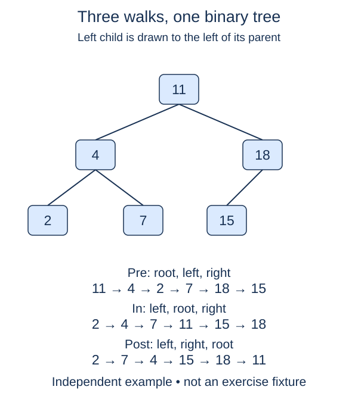

Write a postorder traversal that returns the values of a tree in a specific visiting order. The earlier node and traversal helpers remain completed; the new visitor and its public result wrapper are your tasks.

## Work through the idea

Postorder records a node after both child subtrees. With a root ten and leaf children four and fifteen, visit four, then fifteen, then ten. With deeper children, complete their work before their parent appears.

Start with the familiar empty-subtree check. Recurse left, recurse right, and only then append the current value to one shared result list. Nothing about the node representation changes. Moving the append changes when the visitor performs its own work relative to the two recursive calls.

This order is useful when a parent's result depends on completed child results. The earlier count and height functions already combined child answers after recursion, even though they returned numbers rather than recording a traversal. Here you are making that child-before-parent timing visible.

Keep left before right consistently. Reversing preorder is not generally the same as left-first postorder; reversal changes sibling order too. Trace a root whose left child has two children to see the difference. An explicit recursive visitor follows the contract directly and is easier to adapt later.

## Build it in checkpoints

The recursive work lives in `visit_postorder(node, result)`. A supplied empty-node guard ends missing branches. Append into the list passed by the caller; do not clear it or replace it. The helper can therefore be checked with an existing prefix before the public `postorder` function is complete. The public function's separate responsibility is to own a fresh result list for each call, invoke the visitor, and return that list.

## Contract and cost

Return a new list on every call, including for `None`. Preserve duplicate values and all child identities. Visit each node once in left, then right, then root order. This is a proper binary tree, not necessarily a search tree. Do not sort values, mutate links, or use a persistent result list shared between calls.

With one shared append-only result, time is O(n). The output uses O(n) space and recursion uses O(h) additional stack space. Concatenating separate subtree lists at every level can instead cause O(n²) copying on a chain; use the supplied empty function body to build one accumulator.

## Your Tasks

1. In `visit_postorder`, visit this node and its two subtrees in postorder order.
2. In `postorder`, return a fresh result list populated by the supplied visitor call.

Edit `main.py`, then press **Run** to inspect the supplied probe and **Submit** to check each task. Complete the numbered changes in order. The supplied code keeps earlier operations available; you do not need to copy anything from another lesson.
