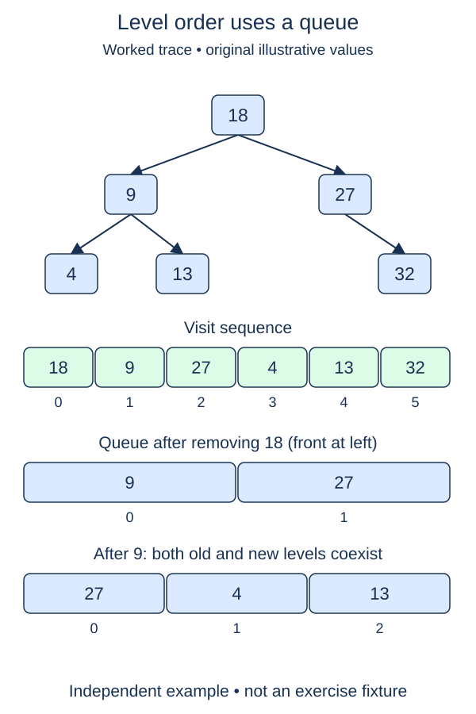

The recursive traversals finish a branch before moving across the tree. Level order instead visits the root, then its children, then its grandchildren. A first-in, first-out queue keeps that frontier in the right order.

## Work through the idea

For a root nine with children four and fourteen, enqueue the root first. Remove nine, record it, and enqueue four followed by fourteen. Removing four may add its children, but fourteen is already ahead of them in the queue. That is why the current level finishes before the next level starts.

The starter imports `deque` from `collections`. Constructing `deque([root])` creates the pending queue; `popleft()` removes its oldest node, and `append()` adds a newer one at the far end. Both end operations take constant time. A list's `pop(0)` would shift its remaining references and can make a broad traversal quadratic.

Only enqueue real children. `None` represents an absent edge, not a node to report. Enqueue the left child before the right child to make ordering deterministic within each level. Since these inputs are proper trees, each node has one parent and is enqueued once; a visited set is unnecessary here.

Keep the queue separate from the result list. The queue contains nodes whose children you still need to inspect, whereas the output contains only the already recorded values.

## Build it in checkpoints

`enqueue_children` handles one node's contribution to the frontier. Append only real children, left before right, behind any nodes already waiting. Test this helper first with an existing queue item. The outer `level_order` loop can then focus on removing the oldest node, recording its value, and delegating child discovery. The empty case, fresh result, initial queue, and final return are supplied; your second task changes only the processing loop.

## Contract and cost

Return a new list of integer values in breadth-first, left-to-right level order. Empty input returns `[]`. Preserve duplicates, node values, and child links. Use the supplied `deque` rather than a stack or a list with front removals. Previous traversal helpers stay unchanged.

Time is O(n). Output space is O(n), and the queue needs O(w) auxiliary space where w is maximum level width (up to a constant factor while two levels overlap). A broad tree can need O(n) queue space; a chain needs only O(1).

## Your Tasks

1. In `enqueue_children`, append existing children left first without disturbing the pending queue.
2. In `level_order`, process pending nodes in FIFO order, recording each value and queuing its children.

Edit `main.py`, then press **Run** to inspect the supplied probe and **Submit** to check each task. Complete the numbered changes in order. The supplied code keeps earlier operations available; you do not need to copy anything from another lesson.
