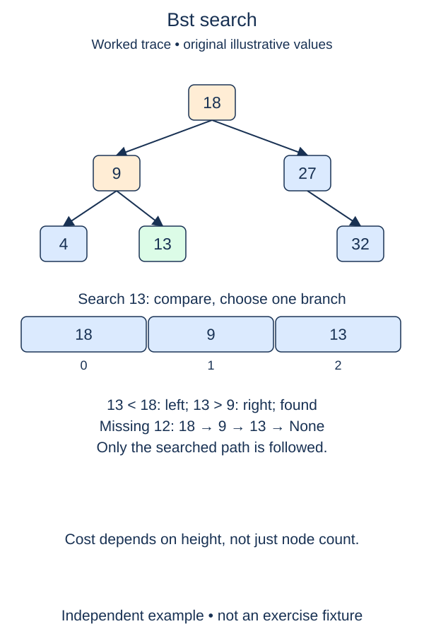

A binary search tree adds an ordering rule to the node structure: every value in a node's left subtree is smaller, and every value in its right subtree is larger. That rule lets a lookup ignore one entire subtree at each step.

## Work through the idea

Consider a root thirteen with left child six and right child nineteen. Searching for eight first moves left because eight is below thirteen. At six, it moves right because eight is above six. Continue until you find the value or reach a missing child.

Use a local cursor that starts at `self.root`. Equality means success. Otherwise choose exactly one child using the comparison with the current value. Reaching `None` means the chosen path has no matching value, so return false. Do not change `self.root` while moving the cursor; doing so would discard the caller's access to earlier parts of the tree.

The rule applies to whole subtrees, not only immediate children. A value under the left child of thirteen must remain below thirteen even if it sits on a right-hand edge lower down. This global restriction is what makes excluding the other subtree safe.

The new `BST` wrapper stores a root reference; construction itself does not insert values or rebalance anything. Earlier traversal functions can still inspect `tree.root`. Here the supplied trees already satisfy the strict ordering rule. The insertion lesson will enforce a no-duplicate policy when building them.

## Build it in checkpoints

First implement `next_branch` for a key already known to differ from the current node. It returns the existing left or right reference; a missing child remains `None`. The search controller handles equality itself and repeatedly uses this decision helper. Separating the branch choice from the loop makes it easier to catch an accidentally reversed comparison.

## Contract and cost

Implement `contains(value)` for integer keys and return a boolean. Empty trees return false. Search is read-only and follows one branch at a time. The `Node` and traversal definitions remain completed. A duplicate key will represent the same set member, not a second node, in this BST design.

Lookup costs O(h) time and O(1) auxiliary space with an iterative cursor. Only a balanced shape gives O(log n) height; a chain has O(n) worst-case lookup. No balance guarantee is supplied by this class.

## Your Tasks

1. In `next_branch`, choose the existing child that could contain a different search key.
2. In `BST.contains`, follow one search branch until a match or missing child, without changing the root.

Edit `main.py`, then press **Run** to inspect the supplied probe and **Submit** to check each task. Complete the numbered changes in order. The supplied code keeps earlier operations available; you do not need to copy anything from another lesson.
