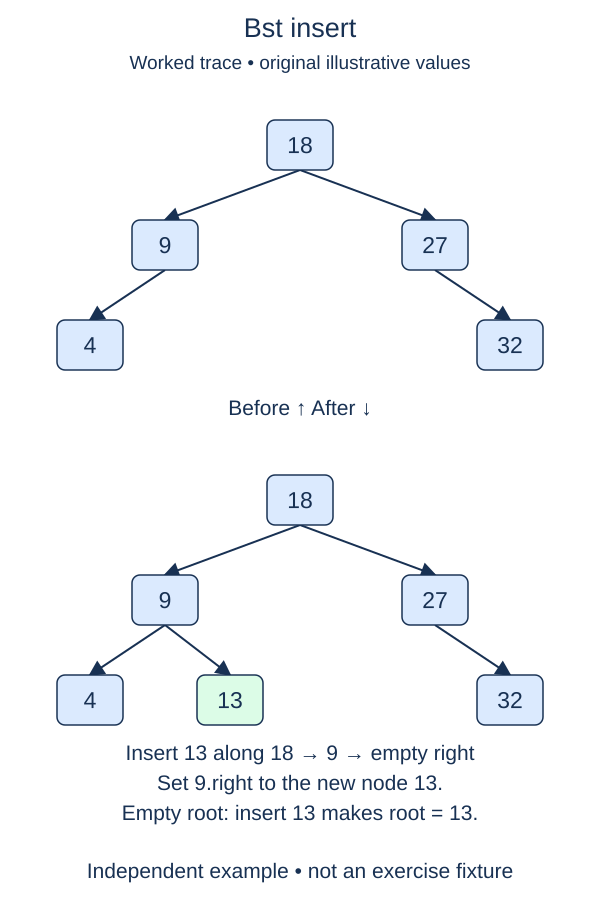

Turn the read-only search tree into a set-like collection. Insertion follows the same branch decisions as lookup, but a missing child becomes the place to attach one new node.

## Work through the idea

Starting from an empty tree, inserting ten creates the root. Inserting four follows the left direction and attaches a leaf. Inserting seven moves left from ten, then right from four. Existing nodes keep their positions and identities.

Handle the empty-root case first because there is no parent link to update. Otherwise keep a cursor on a real node. Compare the requested value with the current value. Equality returns false: this course's BST stores distinct integer keys. For a smaller value, either descend left or attach a node if that child is missing. Use the symmetric rule on the right for a larger value.

Attach only after you have found the missing link. Replacing a nonempty child would lose its entire subtree. Creating a new root on every call would also break the existing structure. The new leaf starts with both child references set to `None`, which the completed constructor already handles.

Insertion order affects shape. Entering increasing values repeatedly makes each new node the right child of the previous one. The keys are valid and searchable, but the tree becomes a chain. This operation does not include rotations or any other balancing procedure.

## Build it in checkpoints

The search loop and its direction changes are supplied. Fill the four outcomes separately: creating an empty root, rejecting equality, attaching a missing left child, and attaching a missing right child. Each test constructs its own tree, so a left-link insertion does not depend on first implementing right-link insertion. Do not replace the supplied descent statements with recursive copies of the tree.

## Contract and cost

`insert(value)` returns `True` only when it adds a new integer key and `False` for a duplicate. On a duplicate, leave all references unchanged. Keep `contains` and all earlier helpers intact. Separate BST instances own separate roots; creating one must not reset another.

One insertion takes O(h) time and O(1) auxiliary cursor space, plus O(1) storage for a successful new node. Building n sorted keys this way can take O(n²) total time and produce height n.

## Your Tasks

1. In `BST.insert`, create the root when inserting into an empty tree.
2. In `BST.insert`, reject a duplicate key without changing any links.
3. In `BST.insert`, attach a new leaf at a missing left link.
4. In `BST.insert`, attach a new leaf at a missing right link.

Edit `main.py`, then press **Run** to inspect the supplied probe and **Submit** to check each task. Complete the numbered changes in order. The supplied code keeps earlier operations available; you do not need to copy anything from another lesson.
