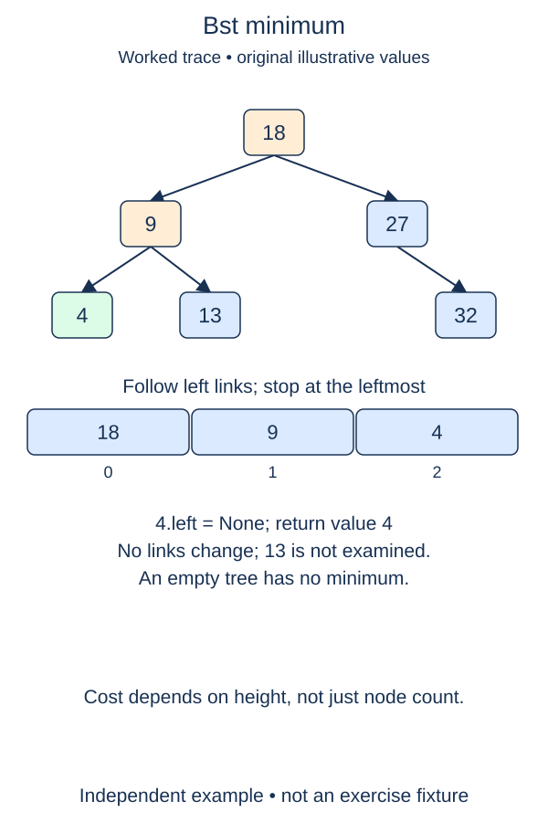

The smallest key in a search tree does not require checking every node. Follow left links until there is no smaller subtree left to inspect. This lookup will also help explain the replacement choice used in two-child deletion.

## Work through the idea

For a root fourteen with a left child eight and that child's left child three, the minimum is three. A right child under three may contain a larger key, but cannot contain the minimum because the entire right subtree must be larger than three.

First decide what to do with an empty tree. This method returns `None`, which is distinct from every allowed integer key, including zero. For a nonempty tree, keep a local cursor and move it while its left child exists. The last real node on that path contains the answer.

The loop condition differs from the earlier membership search. You do not want to step into `None` and then read its value. Stop when the current node has no left child, and return the current value. A tree whose root has no left child already has its minimum at the root, even if it has a large right subtree.

This is a read operation. Changing `self.root` to walk left would silently discard the rest of the tree. Keep the root reference and all child links intact so later insertions and searches still work. The completed `contains` and `insert` methods stay in the starter.

## Contract and cost

Return the smallest integer key, or `None` for an empty BST. Do not remove it, return a node object, or create a list of all values. Follow the leftmost path using the strict BST invariant. Zero and negative keys are ordinary valid answers, not empty-tree signals.

Time is O(h) in the worst case and auxiliary space is O(1). If the root has no left child, this particular lookup is O(1), even if other paths are long. The overall BST remains unbalanced.

## Your Tasks

1. In `BST.minimum`, return `None` when the tree has no minimum.
2. In `BST.minimum`, read the leftmost key without changing any link.

Edit `main.py`, then press **Run** to inspect the supplied probe and **Submit** to check each task. Complete the numbered changes in order. The supplied code keeps earlier operations available; you do not need to copy anything from another lesson.
