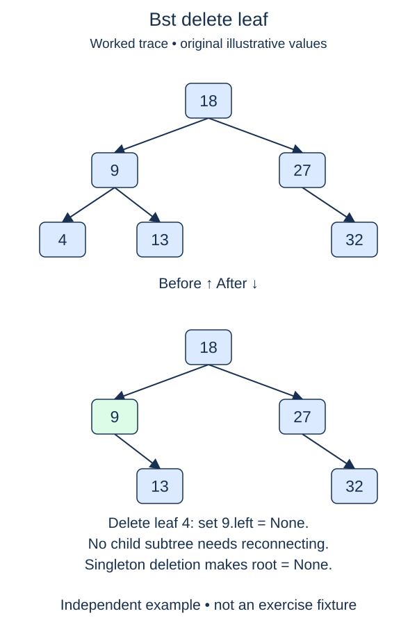

Deletion has several shapes, so begin with the case that cannot lose descendants: removing a leaf. A leaf has neither a left nor a right child. Disconnecting it changes exactly one incoming link.

## Work through the idea

In a tree with root nine and children four and fifteen, deleting four sets the root's left reference to `None`. The other child stays untouched. If the entire tree is one node, deleting that leaf must set `self.root` to `None` instead because there is no parent object.

Two supplied helpers isolate link bookkeeping. `_locate(value)` follows the search path and returns `(parent, node)`; a missing key has `node is None`. `_replace(parent, node, replacement)` changes the incoming parent link, or the tree's root when the parent is absent. It compares node identity to decide which link belongs to the found node. These helpers are complete scaffolding, not extra tasks.

Your method first locates the target, then checks both children. A node with even one child is outside this stage's deletion capability. Return false without changing anything in that case. For a leaf, replace the incoming link with `None` and report success.

Do not confuse a leaf with a node whose value is zero, or a node that has only one missing child. The shape of the references determines the case. Later lessons will reuse these helpers and this completed method rather than replacing the tree implementation.

## Contract and cost

`delete_leaf(value)` returns `True` for a removed leaf and `False` for an absent key or a nonleaf. Rejected requests leave the entire tree unchanged. Preserve every other node's identity and value. Earlier methods remain complete. The helpers use integer keys and the existing no-duplicate BST policy.

Finding the target costs O(h); checking its children and unlinking it cost O(1). Auxiliary space is O(1). The operation does not rebalance the remaining tree.

## Your Tasks

1. In `BST.delete_leaf`, reject a missing key or a node with any child.
2. In `BST.delete_leaf`, disconnect the found leaf and report successful removal.

Edit `main.py`, then press **Run** to inspect the supplied probe and **Submit** to check each task. Complete the numbered changes in order. The supplied code keeps earlier operations available; you do not need to copy anything from another lesson.
