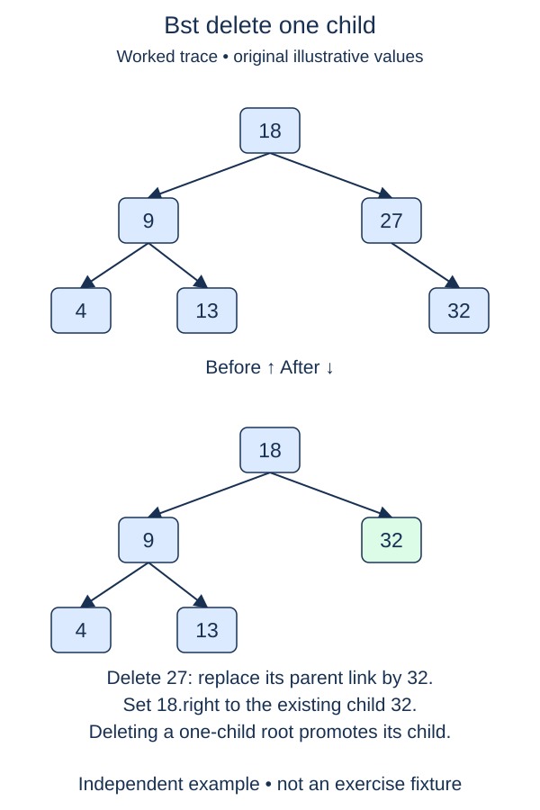

A node with one child can be removed without searching for a replacement value. Its only child can take over the incoming link. Extend deletion by adding this method while retaining the completed leaf method.

## Work through the idea

Suppose root ten has left child four, and four has right child seven. To remove four, connect ten's left link directly to the existing seven node. Seven already satisfies the ancestor's ordering restrictions because it belonged to that subtree. Any descendants of seven move with it; do not copy only its value into a fresh node.

Locate the node and its parent with the supplied helper. An absent key returns false. A leaf delegates to `delete_leaf`, so the previous behavior stays available. A node with two children is still unsupported and must be left untouched. That leaves exactly one child reference to promote.

Save the child reference before disconnecting anything. Pass that object to `_replace`, which also handles promotion at the root. After reconnection, clear the removed node's child references. This explicit detachment matters if another part of a program still holds a reference to the removed node: that old object should no longer expose links into the live tree.

The branch distinction should be based on `is None`, not on the numeric value stored in a child. Zero is a valid key. The old leaf method, searches, insertions, and minimum lookup all remain in the starter.

## Build it in checkpoints

Promotion and detachment are separately observable. Reconnecting the parent or root must preserve the actual child object and its descendants. Only afterward clear links on the removed object. A caller retaining that old object should not still see live descendants through it. The second checkpoint observes the reconnection even while the final detachment placeholder remains unfinished.

## Contract and cost

`delete_one_child(value)` now accepts leaves and one-child nodes. Return `True` on removal, `False` for an absent key or a two-child node. Promote the actual child object, preserve all surviving identities, and detach the removed node's links. Two-child deletion arrives in the next stage.

Search takes O(h), while promotion and detachment take O(1). Delegating a leaf may search again, but two O(h) searches still give O(h) total time. Auxiliary space is O(1).

## Your Tasks

1. In `BST.delete_one_child`, return false when the search finds no node.
2. In `BST.delete_one_child`, delegate a leaf to the completed leaf-deletion method.
3. In `BST.delete_one_child`, reject a node with two children without changing its links.
4. In `BST.delete_one_child`, promote the existing child into the removed node's incoming link.
5. In `BST.delete_one_child`, detach the removed node's links and return success.

Edit `main.py`, then press **Run** to inspect the supplied probe and **Submit** to check each task. Complete the numbered changes in order. The supplied code keeps earlier operations available; you do not need to copy anything from another lesson.
