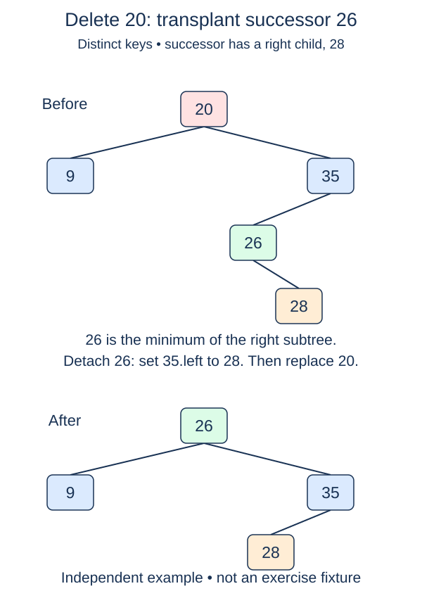

Finish deletion for a node with two children. Neither child alone can replace the node without further work. Instead, copy the next larger key into the target, then unlink the node that originally held that key.

## Work through the idea

The next larger key is the minimum of the target's right subtree, called its inorder successor. Start at the right child and follow left links. The successor has no left child, although it may have a right child. That restricted shape makes its removal a leaf-or-one-child splice.

For a target ten whose right subtree has root eighteen and left child thirteen, thirteen is the successor. If thirteen has a right child fifteen, that fifteen must reconnect to eighteen after thirteen is removed. Saving only the successor value and discarding its child would lose a valid key.

Keep both successor and successor-parent cursors while walking. Copy the successor's value into the original target node, then use `_replace` to reconnect the successor's right child. This also handles the immediate-right-child case, where the successor's parent is the target itself. Finally detach the removed successor object's links.

Do not call an ordinary key-based delete after copying the value: for a moment two nodes have the same key, and a fresh search could find the target instead of the successor. Use the references you already located. For targets with fewer than two children, delegate to the completed previous method.

## Build it in checkpoints

Implement `successor_of` first. Its input is a node known to have a right child, and its result is the successor's parent together with the actual successor node. It must not change either object. The deletion method can then reuse that pair without repeating the search. Its final splice is one coordinated mutation: copying a key without removing the old occurrence would temporarily leave a duplicate, so do not treat the copy alone as a completed deletion.

## Contract and cost

`delete(value)` removes any present integer key and returns `True`; absent keys return `False`. In the two-child case, retain the target object's identity but change its value to its successor's key. Remove and detach the actual successor object. Preserve all other nodes and the strict no-duplicate invariant after the method returns.

Locating the target and then its successor takes O(h) total time and O(1) auxiliary space. This is ordinary unbalanced BST deletion; it makes no logarithmic-height guarantee.

The figure shows the final key arrangement. Here the original target object stays in place and receives the successor key; the successor object is removed. The figure's word "transplant" does not require moving that object into the root position.

## Your Tasks

1. In `successor_of`, locate the leftmost node of the right subtree together with its parent.
2. In `BST.delete`, return false when no matching node exists.
3. In `BST.delete`, delegate a target with fewer than two children to the completed deletion method.
4. In `BST.delete`, copy the successor key, splice its right child upward, and detach the successor.

Edit `main.py`, then press **Run** to inspect the supplied probe and **Submit** to check each task. Complete the numbered changes in order. The supplied code keeps earlier operations available; you do not need to copy anything from another lesson.
