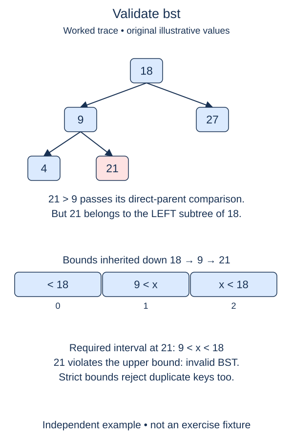

A node can be correctly ordered relative to its parent and still violate an ancestor's rule. Write a validator that carries allowed bounds down the tree rather than checking only neighboring pairs.

## Work through the idea

Take a root ten with a left child four. If four's right child is twelve, the immediate edge four-to-twelve looks correct, but twelve is still inside ten's left subtree and is too large. A validator must remember the upper bound inherited from ten.

Give the separate recursive helper a node, an optional lower bound, and an optional upper bound. A real value must be strictly above the lower bound when one exists and strictly below the upper bound when one exists. Passing left keeps the old lower bound and tightens the upper bound to the current value. Passing right tightens the lower bound and keeps the old upper bound.

Use `None` for an absent bound rather than inventing a smallest or largest integer. Python integers can exceed any chosen sentinel. Strict comparisons also reject duplicate keys anywhere in the tree, matching insertion's set-like policy. A missing child is valid and ends that branch.

The validator does not sort, rebuild, or repair the tree. It only reads the supplied structure and reports whether every node satisfies the inherited constraints. Keep the earlier BST implementation available so you can validate trees built and changed by its methods.

## Build it in checkpoints

`within_bounds` checks one integer against two optional strict limits. Test that decision independently before applying it to a whole tree. `valid_subtree` then carries those limits recursively; `is_bst` is a supplied wrapper that begins with neither bound. Tighten only the limit introduced by the current branch, retaining the other ancestor limit.

## Contract and cost

`is_bst(root)` returns a boolean for a finite proper binary tree with integer keys. Empty trees are valid. Reject ancestor violations and duplicates, including duplicates deeper than one edge. Preserve all node identities, values, and links. Cycles and shared-child graphs remain outside the tree contract.

Worst-case time is O(n), with O(h) recursive stack space. It may stop early on an invalid bound. Validating a tree does not prove that its height is small; a strictly increasing chain is a valid, badly unbalanced BST.

## Your Tasks

1. In `within_bounds`, check one key against optional strict lower and upper bounds.
2. In `valid_subtree`, validate every subtree using inherited bounds and the single-key check.

Edit `main.py`, then press **Run** to inspect the supplied probe and **Submit** to check each task. Complete the numbered changes in order. The supplied code keeps earlier operations available; you do not need to copy anything from another lesson.
