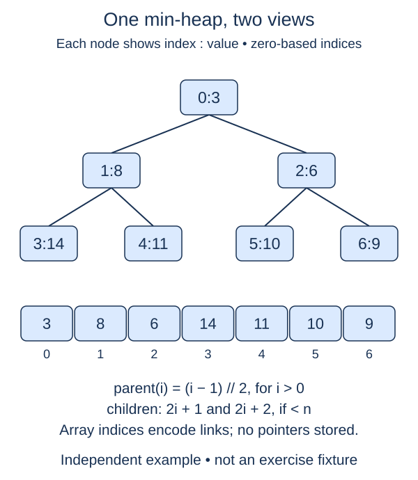

A binary heap stores a complete binary tree in a compact list. Because every level fills left to right, child positions can be calculated from an index instead of stored as node references. Write that index calculation before changing any heap values.

## Work through the idea

Number the root zero, its children one and two, and the next level three through six. For index one, the child positions are three and four. For index two, they are five and six. The formulas are `2 * index + 1` and `2 * index + 2`.

For a nonroot index, integer division in `(index - 1) // 2` finds its parent. Handle the root separately: applying the formula at zero produces minus one, which Python would interpret as the last list position. That is not a parent.

A calculated child index may lie beyond the list. Return `None` for that child rather than returning an invalid position. For a heap with six elements, the node at position two has a left child at five but no right child. This incomplete final level is still a complete binary-tree shape because there are no gaps before the missing rightmost position.

These calculations describe shape only. They do not establish heap order, and the list does not need to be sorted. The next lesson will check the separate parent-child value rule.

## Contract and cost

`family_indices(index, size)` returns `(parent, left, right)` with missing relatives represented by `None`. Inputs are integers; require `0 <= index < size`, otherwise raise `IndexError`. The tuple hint uses `int | None` because an index may be absent. No list or tree needs to be allocated.

The calculation uses O(1) time and O(1) space under bounded-index arithmetic. A compact heap list stores n references without separate left/right link fields.

## Your Tasks

1. In `family_indices`, reject an index outside the heap shape.
2. In `family_indices`, return the parent and existing child positions, using `None` for missing relatives.

Edit `main.py`, then press **Run** to inspect the supplied probe and **Submit** to check each task. Complete the numbered changes in order. The supplied code keeps earlier operations available; you do not need to copy anything from another lesson.
