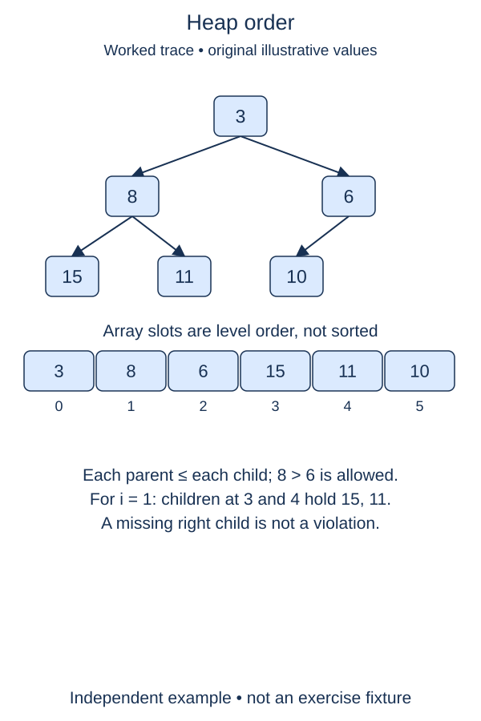

The compact list gives a heap its shape. A min-heap adds an order rule: every parent is no larger than either child. Check that rule without requiring the entire list to be sorted.

## Work through the idea

The list `[1, 6, 3, 9, 8, 4]` is a valid min-heap. Six appears before three in the array, but neither is the other's parent. Both exceed the root, and each of their children respects the local rule. A sorted-list check would reject this valid arrangement.

Visit every nonroot position and calculate its parent. If the child is strictly smaller than the parent, one violated edge is enough to reject the heap. If no edge violates the rule, all parent-child relationships are valid. Equal values are allowed; a heap may contain many copies of the same number.

The root must be a minimum because following parent links from any node repeatedly reaches the root without increasing toward it. That does not tell you which child holds the second-smallest value, or whether sibling subtrees are in order relative to each other. A heap is designed for efficient access to one extreme, not for binary search through the list.

Empty and singleton lists have no parent-child edges, so they satisfy the rule without comparisons. The index helper from the preceding lesson stays available, although the single parent formula is enough for this scan.

## Contract and cost

Return a boolean and leave the supplied list unchanged. Accept comparable values and duplicates. Check actual parent-child edges, not neighboring array positions and not the strict BST ordering rule. This function validates heap order; it does not repair a damaged heap.

Checking all edges takes O(n) time and O(1) auxiliary space. Once heap order is known, reading a nonempty heap's root is O(1), but this full validation is not.

## Your Tasks

1. In `is_min_heap`, check every nonroot item against its parent without changing the list.

Edit `main.py`, then press **Run** to inspect the supplied probe and **Submit** to check each task. Complete the numbered changes in order. The supplied code keeps earlier operations available; you do not need to copy anything from another lesson.
