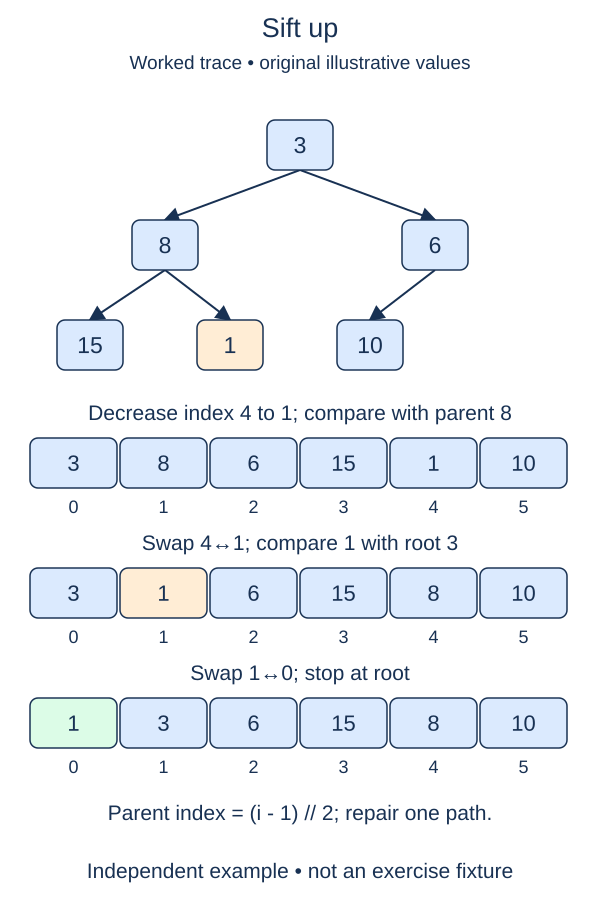

Appending a new leaf preserves a heap's complete shape, but the new value may be smaller than its parent. Sift-up repairs that one upward path. This lesson starts a real `MinHeap` class that later lessons will extend.

## Work through the idea

Suppose the heap is `[2, 7, 4, 10]` and a new value three is appended. Its parent is seven, so exchange those two values. Three is now below two, which already satisfies the min-heap rule, so stop. Other branches did not need inspection.

The local precondition matters: before the append, the prefix was a valid heap. The only possible violations lie between the new item and its ancestors. After an exchange, the displaced parent moves down into a position whose other relationships remain valid. Move the cursor to the parent index and repeat.

Check `index > 0` before calculating or using a parent. At the root there is nowhere further to go. Stop on equality as well as on a larger child; equal values already satisfy heap order and need no movement.

The constructor is supplied and makes a shallow copy of its argument into `self.data`. It deliberately does not heapify arbitrary values yet. For this exercise, use it with a valid heap prefix plus one appended leaf. The method's leading underscore marks it as an internal repair helper rather than a general sorting operation.

## Build it in checkpoints

The one-level helper `rise_once(values, index)` returns the item's new index. If the item is already at the root or its parent is no larger, return the same index without mutation. Otherwise exchange the pair and return the parent index. `_sift_up` repeats this small repair until the index stops changing. The tests inspect both a one-level intermediate state and the completed path.

## Contract and cost

Mutate `self.data` in place and return `None`. Assume `index` is a valid newly appended leaf position with a min-heap prefix, or a decreased value whose only possible violations lie on its upward path. Preserve all values, including duplicates. Use parent comparisons and exchanges along this path, not sorting or a library heap. Previous index and validation helpers remain completed.

A complete heap has logarithmic height, so sift-up takes O(log n) worst-case time and O(1) auxiliary space. It may stop after one comparison. Copying constructor input is a separate O(n) operation.

The figure decreases an existing leaf rather than appending a new one. Both create the same upward-path violation, and the repair helper handles either case when the remaining edges already obey heap order.

## Your Tasks

1. In `rise_once`, repair one parent-child inversion and return the item's resulting index.
2. In `MinHeap._sift_up`, repair the upward path by repeatedly calling `rise_once`.

Edit `main.py`, then press **Run** to inspect the supplied probe and **Submit** to check each task. Complete the numbered changes in order. The supplied code keeps earlier operations available; you do not need to copy anything from another lesson.
