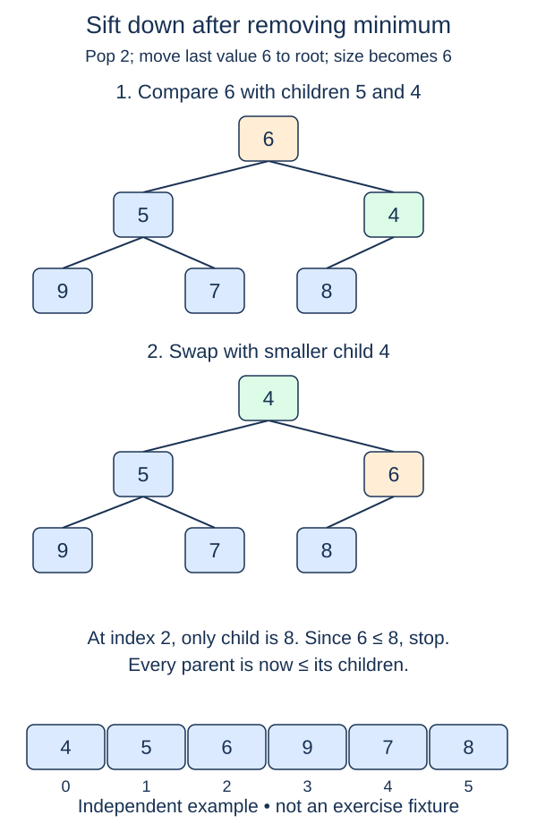

Sift-up repairs a value that may be too small for its parent. Sift-down repairs a value that may be too large for its children. Add this complementary helper to the same class without changing the completed upward repair.

## Work through the idea

For `[9, 3, 5, 7, 8, 6]`, the root is too large. Compare its children and choose three, the smaller one. Exchange nine with three, then continue from nine's new position. Choosing five instead would leave three below a larger parent, so selecting the smaller child is necessary.

At each position, calculate the left child first. If no left child exists, the node is a leaf and the repair is finished. A right child is optional; compare it only when its index is inside the list. Choose the right child only when it is strictly smaller than the left, so equal children consistently favor the left.

If the chosen child is not smaller than the current value, both child relationships are valid and you can stop. Otherwise exchange and move down. The child subtrees must already be heaps. That precondition means the only uncertain value after the exchange is the one you moved downward.

This helper is not an arbitrary heap builder by itself. Calling it once at the root cannot fix a violation hidden in an unrelated subtree. The bottom-up construction lesson will call it in an order that establishes the child-subtree precondition.

## Build it in checkpoints

Implement `smaller_child` separately from the swapping loop. It returns `None` at a leaf, the only existing child when there is one, or the smaller child's index when both exist. Favor the left on equal values. The repair loop then needs only one candidate comparison per level and must leave unrelated branches unchanged.

## Contract and cost

Repair the subtree rooted at a valid `index`, preserving the rest of the list. Its child subtrees are already valid heaps. Mutate the existing list and return `None`. Use strict comparisons and choose the left child on equal keys. Keep `_sift_up` unchanged. No sorting or library heap calls are needed.

Worst-case time is O(log n), because each exchange moves one level down a complete tree. The loop uses O(1) auxiliary space. A leaf requires only the boundary check.

The figure starts after a root replacement. Removing the minimum will be implemented later; this lesson owns only the downward repair shown afterward.

## Your Tasks

1. In `smaller_child`, choose the smaller existing child, favoring the left on a tie.
2. In `MinHeap._sift_down`, move down through smaller children until the subtree obeys heap order.

Edit `main.py`, then press **Run** to inspect the supplied probe and **Submit** to check each task. Complete the numbered changes in order. The supplied code keeps earlier operations available; you do not need to copy anything from another lesson.
