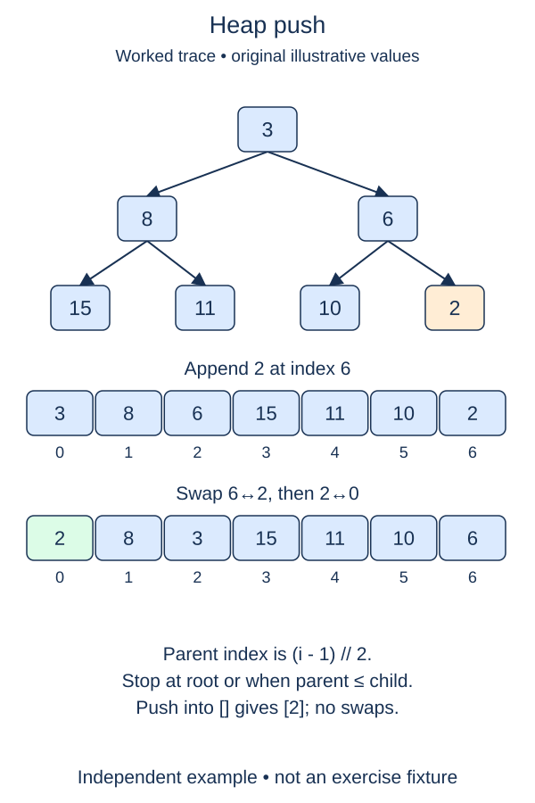

The repair routines are ready. Heap insertion now has two coordinated parts: preserve the complete shape by appending a leaf, then restore order with the completed sift-up helper.

## Work through the idea

Appending to the list puts a value in the next open position on the final tree level. Inserting at an arbitrary position or at the front would move many existing positions and break the parent-child interpretation. Once appended, the new item has one possible upward path, which `_sift_up` already knows how to repair.

The new leaf's index is the list's length minus one after appending. That timing matters: using the old final index would repair an existing item instead. Pass the new index to the helper and let it move the value as far as necessary.

For an empty heap, appending creates the root at index zero. Sift-up then performs no exchanges, so you do not need a separate empty special case in this method. Equal values are also valid; the helper leaves an equal child where it is.

`push` changes the collection rather than producing a sorted list. After inserting several values, the root is minimal but the remaining array can look unsorted. Use the completed validator to inspect the invariant, not a comparison with an entirely sorted array. The supplied Run probe prints the representation so you can trace those positions.

## Contract and cost

`push(value)` appends one comparable value, restores min-heap order, and returns `None`. The existing data must already be a valid heap. Call `_sift_up` on the newly appended index; do not rebuild or sort the entire heap. Duplicate values are separate entries. Independent instances must not share their lists.

Sift-up costs O(log n) worst case. Python list append is amortized O(1), so push is amortized O(log n); a particular resizing append can copy O(n) references. The repair itself uses O(1) space beyond the stored item.

## Your Tasks

1. In `MinHeap.push`, append the new leaf and pass its index to the completed sift-up helper.

Edit `main.py`, then press **Run** to inspect the supplied probe and **Submit** to check each task. Complete the numbered changes in order. The supplied code keeps earlier operations available; you do not need to copy anything from another lesson.
