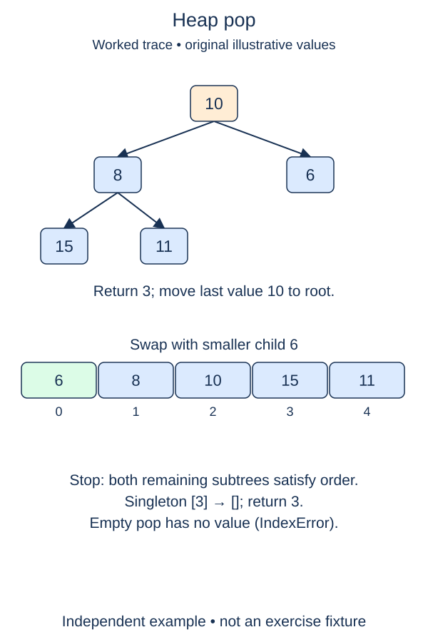

Remove the minimum without shifting the entire list. The root contains the answer, but deleting position zero directly would move every other index. Instead, use the final leaf to fill the root's vacancy and repair downward.

## Work through the idea

For `[1, 4, 2, 8, 6]`, save one as the return value. Remove the final six, put it at the root, and sift it down. Removing only the final position preserves the complete shape. The child subtrees are still heaps, so root sift-down has exactly the precondition it needs.

Save the root before replacing it. The final item is not necessarily the minimum and should not become the return value by accident. Once you have removed the final slot, check whether the heap still has any items. In a singleton heap, that removal already empties the collection, and there is no root slot to overwrite or repair.

An empty heap needs a defined error before any index access. Raise `IndexError` with a useful message. This matches the idea of popping from an empty collection rather than using a special number that might also be a legitimate key.

The earlier push and sift helpers remain completed. Your method combines them with list-end removal; it does not need a new search for the minimum. Repeated pops will produce sorted values, although the internal list between pops is only heap-ordered.

## Build it in checkpoints

The starter already saves the root and removes the last list slot after your guard. Those supplied lines let you focus on the independent boundary check and the downward repair. The final return is also supplied. On a singleton, the removal leaves no root to overwrite, so skip repair rather than attempting an index-zero assignment.

## Contract and cost

`pop()` removes and returns exactly one smallest value. Raise `IndexError` on an empty heap and leave it empty. Preserve duplicates as separate entries. For a nonempty remainder, call `_sift_down(0)` after moving the final item to the root. Mutate the same stored list rather than replacing it.

Sift-down is O(log n) worst case with O(1) auxiliary state. List-end removal is amortized O(1), so pop is amortized O(log n); implementation resizing can make an individual list operation more expensive. Root peek alone would be O(1).

## Your Tasks

1. In `MinHeap.pop`, raise `IndexError` before accessing an empty heap.
2. In `MinHeap.pop`, restore a nonempty remainder by moving the last value to the root and sifting down.

Edit `main.py`, then press **Run** to inspect the supplied probe and **Submit** to check each task. Complete the numbered changes in order. The supplied code keeps earlier operations available; you do not need to copy anything from another lesson.
