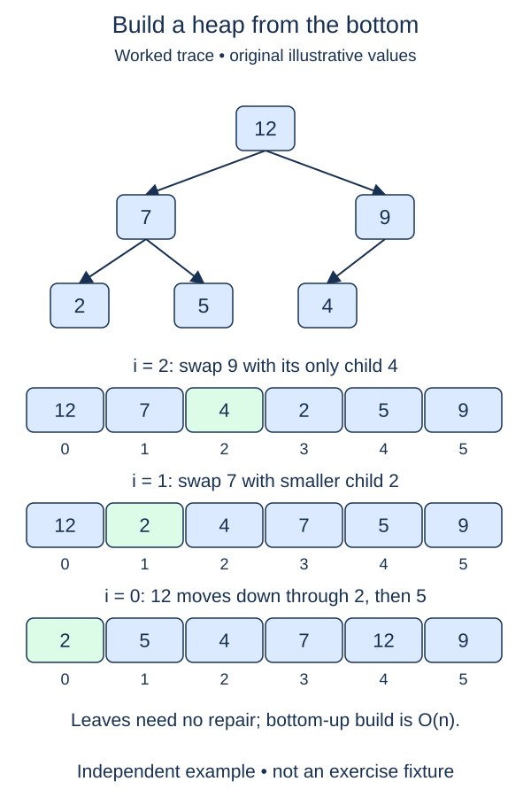

Repeated push can build a heap, but it does more work than necessary when all values are already available. Bottom-up heapify starts with the whole list and repairs parents only after their child subtrees are valid.

## Work through the idea

Every position from `n // 2` onward is a leaf, and a leaf is already a heap. The last parent is therefore `n // 2 - 1`. Sift down that parent, move one position left, and continue back to the root. By the time you repair a parent, its children have larger indices and their subtrees have already been handled.

Going from root toward leaves would violate that reasoning. A single sift-down assumes each child subtree is already a heap; an arbitrary input list does not provide that assumption near the root at the beginning. The reverse index order establishes it one parent at a time.

Copy the supplied values into a new `self.data` list first. This `build` method replaces the heap's previous contents and does not reorder the caller's list. The constructor from earlier stages remains unchanged so its copying behavior stays predictable. Once build finishes, the existing push and pop methods can use the result normally.

The total repair work is linear, not n times a full-height sift. Roughly half the nodes are leaves, a quarter can move only one level, and progressively fewer can move farther. Summing those shrinking groups gives O(n).

## Build it in checkpoints

The new `parent_indices(size)` helper exposes the bottom-up schedule. Its range begins at the last parent and ends at zero inclusive; leaves are absent. The `build` method already makes the owned copy before that schedule is used. First check the schedule for odd, even, empty, and singleton sizes, then connect it to the existing repair operation.

## Contract and cost

`build(values)` replaces the heap with a shallow copy and returns `None`. Call `_sift_down` once for every parent in descending index order. Empty and singleton inputs need no repairs. Do not call repeated `push`, a library heap builder, or a sorter. Equal values are allowed.

Heap construction is O(n) time, including copying. The owned list uses O(n) space; repair state beyond that list is O(1). Repeated insertion instead has an O(n log n) worst-case comparison bound.

## Your Tasks

1. In `parent_indices`, return every parent index from the last parent back to the root.
2. In `MinHeap.build`, sift down each parent in the descending order supplied by `parent_indices`.

Edit `main.py`, then press **Run** to inspect the supplied probe and **Submit** to check each task. Complete the numbered changes in order. The supplied code keeps earlier operations available; you do not need to copy anything from another lesson.
