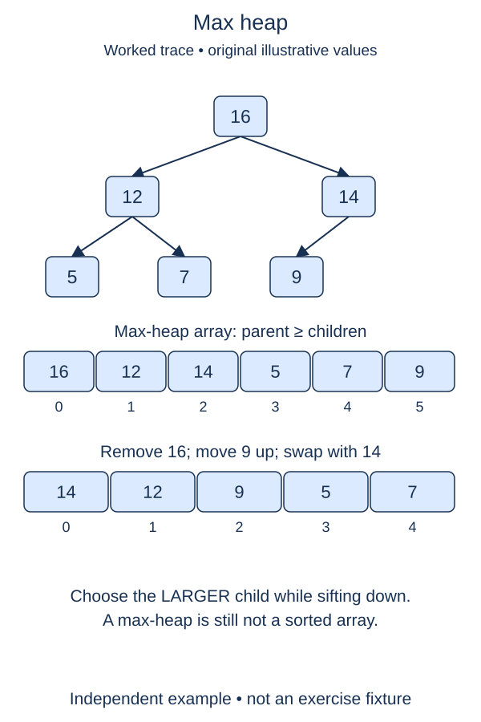

A max-heap exposes the largest value instead of the smallest. Build a fresh numeric variation with actual max-heap order, keeping the completed MinHeap unchanged.

## Work through the idea

The array representation and parent-child index formulas do not change. Only the order rule changes: every parent must be at least as large as each child. Siblings may still appear in either order. A list such as `[15, 8, 12, 2, 6]` is max-heap ordered even though it is not a descending sorted list.

The constructor, push, and pop are supplied as scaffolding. Construction repairs parents bottom-up; pop saves the maximum, moves the final value to the root, and invokes your downward repair. Read these callers before editing the helper. They depend on `_sift_down(index, stop)` respecting an exclusive active boundary.

First write `larger_child(values, index, stop)`. Compute the left child, check whether it exists before `stop`, then consider the right child if present. Choose the left when both values tie. Returning an index rather than a value tells the caller which slot to exchange.

Then implement the repair loop. If there is no child, stop. If the larger child is no greater than the current value, both edges already obey the rule. Otherwise exchange that pair and continue from the child's former index. The child subtrees must already be heaps, just as in min-heap sift-down.

The exclusive boundary is useful beyond removal: the next lesson will leave sorted values at the end of the same array. Your helper must never compare or exchange values outside the active prefix. No new max-heap library APIs or sign encoding are needed.

## Contract and cost

Repair a valid index inside the prefix ending before `stop`; its child subtrees already have max-heap order. Mutate the existing list, leave the suffix untouched, and return None. The empty heap is handled by supplied callers, which never ask you to repair a nonexistent node.

One downward repair takes O(log n) time and O(1) auxiliary space. The supplied bottom-up constructor takes O(n) time and owns an O(n) copy. Push and pop take logarithmic repair work, in addition to amortized list-end operations.

## Your Tasks

1. In `larger_child`, choose the larger child strictly inside the active boundary.
2. In `MaxHeap._sift_down`, repair the active max-heap prefix by exchanging with its larger child.

Edit `main.py`, then press **Run** to inspect the supplied probe and **Submit** to check each task. Complete the numbered changes in order. The supplied code keeps earlier operations available; you do not need to copy anything from another lesson.
