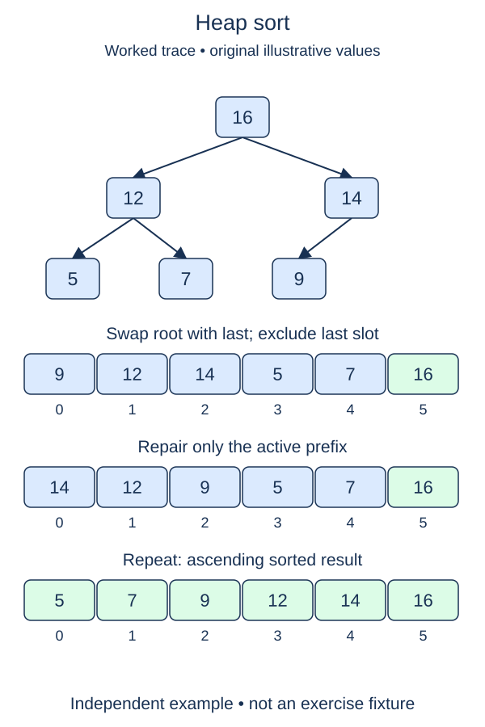

Sort a list in place by moving one maximum at a time into a final suffix. The completed max-heap repair from the previous lesson is supplied unchanged.

## Work through the idea

A max-heap puts the largest active value at the root. Exchange it with the final active position, then exclude that position from future repair. That slot is now correct for ascending order. The value moved into the root may be too small, so sift it down within the shorter prefix.

`extract_maximum(heap, stop)` receives a max-heap prefix covering positions zero through `stop`, inclusive. Swap the root and position `stop`, then call the supplied `_sift_down(0, stop)`. Notice the change in meaning: `stop` is the destination index for the exchange and the exclusive boundary for the repaired remainder. Never repair through the newly settled maximum.

For `[12, 7, 9, 2, 4]`, the first exchange places 12 at the end and moves 4 to the root. Repairing only the first four slots brings 9 to the root. The sorted suffix contains 12 and grows leftward on subsequent extractions.

The public `heap_sort` uses a supplied heap wrapper whose `data` points at the caller's list. This alias is intentional here: unlike the earlier copying constructor, the sort promises in-place mutation. First heapify its parents from the bottom up. Then visit destination positions from the last index back to one, using your extraction helper.

The prefix is heap-ordered while the suffix is fully sorted. Those are different invariants. Returning the array immediately after heap construction would not finish sorting. Empty and singleton lists have no extraction destinations and can return unchanged.

## Build it in checkpoints

The public function already aliases the input, builds its max-heap bottom-up, and returns the same list. First implement one extraction in `extract_maximum`; then fill only the descending extraction loop in `heap_sort`. You do not need to rewrite heap construction.

## Contract and cost

Return the identical list object in ascending order, preserving duplicate occurrences. Use bottom-up max-heap construction and shrinking-prefix extraction. This is a fresh in-place sorting function, not a min-heap drain into a new output list. Heap exchanges do not promise stability.

Bottom-up construction takes O(n) time and repeated extraction takes O(n log n). This iterative in-place implementation uses O(1) auxiliary state; the wrapper aliases the input and does not copy it. Comparisons are assumed constant-cost.

## Your Tasks

1. In `extract_maximum`, move the active maximum to its final slot and repair only the shorter prefix.
2. In `heap_sort`, call the extraction helper for destination indices from the final index down to one.

Edit `main.py`, then press **Run** to inspect the supplied probe and **Submit** to check each task. Complete the numbered changes in order. The supplied code keeps earlier operations available; you do not need to copy anything from another lesson.
