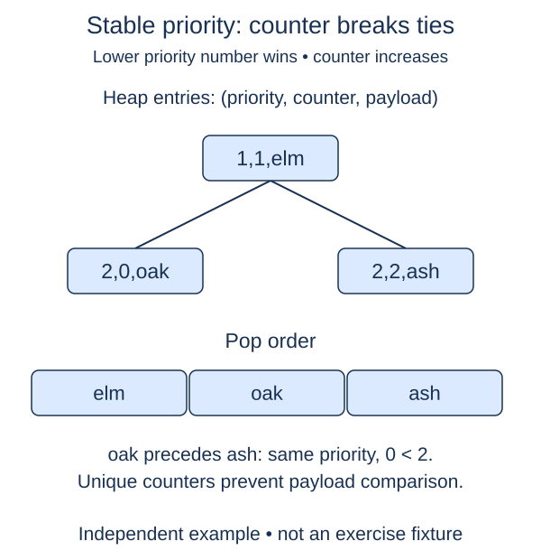

A repair desk serves lower numeric priorities first, but equal-priority jobs should keep arrival order. A heap of `(priority, task)` pairs is not enough: Python would compare the tasks when priorities tie, and arbitrary task objects may not support ordering.

## Work through the idea

Store three fields instead: `(priority, ticket, task)`. Python compares tuples left to right. Different priorities decide the order immediately. Equal priorities compare the ticket, which is a unique increasing integer. Because tickets never tie within one queue, tuple comparison never reaches the task payload.

If two priority-three jobs arrive with tickets zero and one, the first job leaves first regardless of their names or types. A later priority-one job still leaves before both because priority is the first field. This is stable priority ordering rather than ordinary FIFO ordering across all jobs.

The constructor supplies an empty heap and a counter starting at zero. Your push method builds an entry using the current counter, increments the counter for the next insertion, and calls `heapq.heappush`. The supplied pop method removes an entry and returns its task field. It raises `IndexError` when the queue is empty.

Do not reset the counter when an item is popped, and do not use the current heap length as a ticket. After removals, that length can repeat a ticket that is still active. The monotonically increasing counter belongs to each queue instance.

## Build it in checkpoints

Ticket reservation is a separate `_take_ticket` method. Return the current counter, then advance the stored counter for the next call. Its test does not need heap insertion to work. The supplied call inside `push` reserves that ticket; your second change builds and inserts the stable entry. A pop never resets the counter.

## Contract and cost

`push(task, priority)` accepts any payload and an integer priority, returns `None`, and preserves FIFO order among equal priorities. Smaller priorities leave first. Duplicate payload objects are allowed as separate entries. `Any` in the payload hint documents that task comparison is unnecessary. Use the supplied tuple layout and counter.

Heap insertion and removal take O(log n) heap-repair work, with amortized list growth. The queue stores O(n) entries. Ticket arithmetic is treated as constant-cost for ordinary bounded workloads; unbounded integer growth has its own size cost.

## Your Tasks

1. In `PriorityQueue._take_ticket`, reserve and return a unique increasing ticket for this queue.
2. In `PriorityQueue.push`, push a `(priority, ticket, task)` entry using the reserved ticket.

Edit `main.py`, then press **Run** to inspect the supplied probe and **Submit** to check each task. Complete the numbered changes in order. The supplied code keeps earlier operations available; you do not need to copy anything from another lesson.
