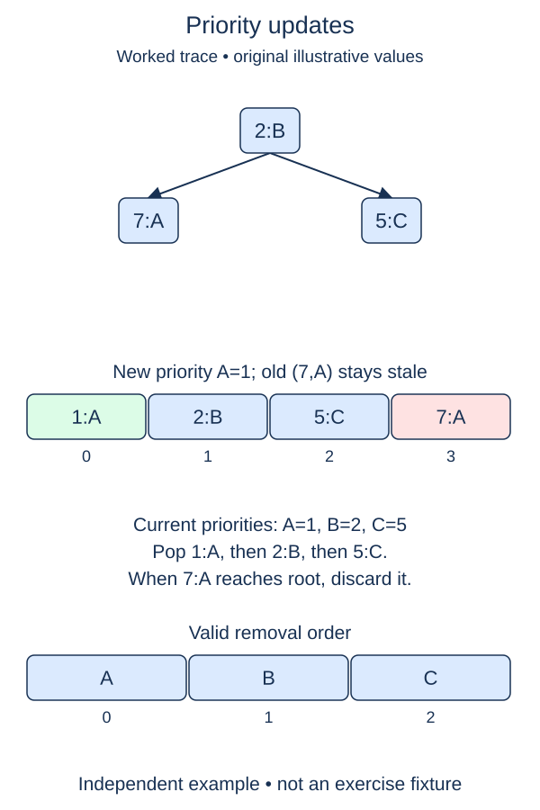

A waiting job's priority can change. Editing its tuple in place would break heap order, and locating arbitrary entries inside a heap is not cheap. Use lazy updates: push a new version and mark the old version obsolete without removing it immediately.

## Work through the idea

The new `UpdatingQueue` is an explicit variation for unique string task IDs. It keeps the stable tuple layout but adds `_active`, a dictionary mapping each live task to its latest ticket. An update takes a fresh counter ticket, records it for the task, and pushes a new `(priority, ticket, task)` tuple. Updating the dictionary invalidates every older ticket for that task.

The supplied `_discard_stale` checks the root against the active ticket. A mismatch means the root is obsolete, so it removes that entry and tries again. `peek` calls that cleanup and returns `(task, priority)` without removing the current job. `pop` uses peek, removes the live root, and deletes its active mapping. These complete helpers show how your new version marker will be consumed.

An update is a new arrival for tie-breaking, even if its priority is unchanged. If job A is updated after job B at the same priority, B leaves first. A popped task can later be scheduled again with a new ticket. Do not reuse tickets: an old stale entry must never become valid again by accident.

## Build it in checkpoints

Version publication is visible separately in `_publish(task)`: reserve a never-reused counter value, make it the task's active ticket, and return it. That mapping invalidates old entries without touching the heap. The supplied first line of `update` uses the returned ticket; the second checkpoint adds the new heap entry. The two operations together complete an update, so callers should not invoke peek between them.

## Contract and cost

Complete only `update(task, priority)`, for string IDs and integer priorities. It inserts missing tasks or supersedes existing ones and returns `None`. Preserve the earlier `PriorityQueue` class unchanged; this new variation has a different public pop result. Never mutate old heap entries or scan for them.

An update costs O(log m) heap work, where m includes stale entries, plus expected O(1) dictionary work. One peek or pop may discard many stale entries, costing O((s + 1) log m) when s entries are removed. Storage is O(m), not O(number of live tasks); this simple version does not compact stale history.

The drawing abbreviates entries to priority and task ID. Your implementation also stores unique version tickets so an older entry never becomes live again.

## Your Tasks

1. In `UpdatingQueue._publish`, publish a fresh active ticket for a task and return that ticket.
2. In `UpdatingQueue.update`, push the new priority entry while leaving old versions in the heap.

Edit `main.py`, then press **Run** to inspect the supplied probe and **Submit** to check each task. Complete the numbered changes in order. The supplied code keeps earlier operations available; you do not need to copy anything from another lesson.
