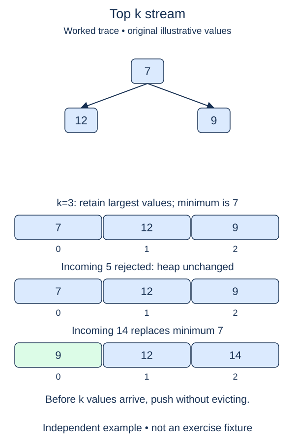

A stream may be too large to keep in full when you only need its largest few values. Maintain a min-heap containing at most k candidates. The root is the weakest retained candidate, so it tells you whether a new value deserves a place.

## Work through the idea

For k equal to three, retain the first three values as a heap. Once full, compare each incoming value with the root. A value no larger than the root cannot improve the largest-three set, so discard it. A larger value replaces the root and triggers heap repair.

`heapq.heapreplace(heap, value)` removes the current minimum and inserts the new value in one operation. It requires a nonempty heap. That is why you first fill the heap and handle k equal to zero before considering replacements. A negative k is not meaningful and should raise `ValueError` before consuming the stream.

The invariant after each consumed item is that the heap contains the largest min(k, items-seen) values, counting duplicates separately. Equal candidates may be discarded when full because they do not change the numeric multiset of the answer. This lesson makes no identity or stable-order promise among equal objects; values are integers.

At the end, repeatedly pop to obtain ascending values, then reverse that small result to return descending order. Reversing a list is not sorting it. This is a fresh streaming function, independent of the task-ID update queue from the preceding lesson.

## Build it in checkpoints

`retain_candidate` receives a valid heap and a positive capacity. It owns only the admission decision: push while there is room, replace a full heap's minimum only for a strictly larger candidate, and otherwise do nothing. The public function already iterates the stream. Complete its capacity guard and final output separately from this per-item decision.

## Contract and cost

`top_k(values, k)` accepts a one-pass iterable of integers and a nonnegative integer k. Return at most k values in descending order, retaining duplicates. For k zero, return `[]` without consuming input. Do not materialize or sort the full stream. Keep the heap size at most k; `Iterable[int]` allows lists and generators.

For n consumed values and k >= 1, work is O(n log(k + 1) + k log(k + 1)) as a convenient upper bound, with O(k) retained storage including output. More precisely, only min(n, k) items need final draining. When k is zero, work is O(1).

## Your Tasks

1. In `retain_candidate`, keep one incoming candidate only when capacity or its value justifies admission.
2. In `top_k`, reject negative k and return immediately for zero without consuming input.
3. In `top_k`, drain and reverse the retained heap to return descending results.

Edit `main.py`, then press **Run** to inspect the supplied probe and **Submit** to check each task. Complete the numbered changes in order. The supplied code keeps earlier operations available; you do not need to copy anything from another lesson.
