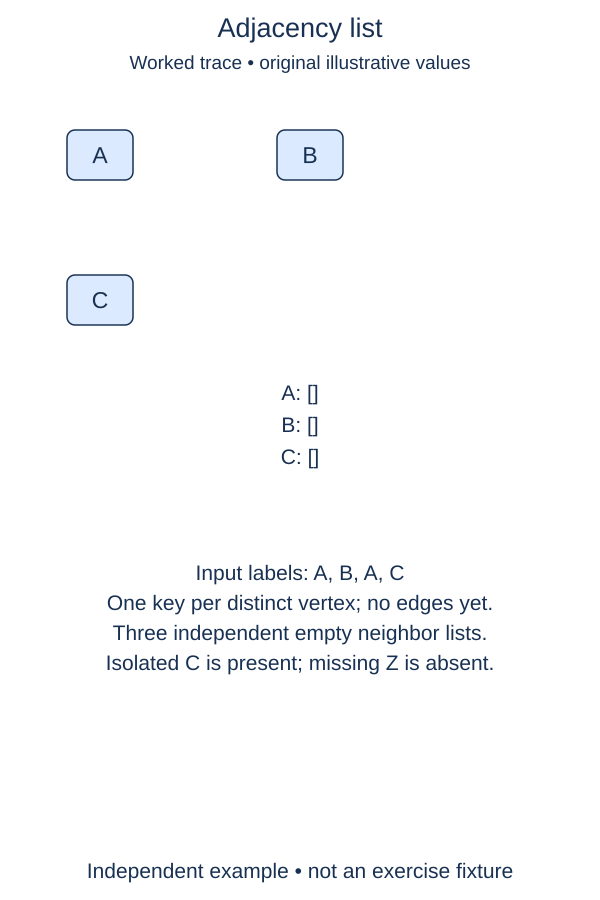

Build the empty connection map for a workshop floor before adding any links.

A graph describes objects and the connections between them. Each object is a vertex; an edge records one connection. A graph does not need a root, and a vertex may exist without any edges. That last point matters for a workshop station that has been registered but not wired into the floor network.

Our first representation is a dictionary named `adj`. Each key is a string vertex label, and its value is a list of neighboring labels. The outer dictionary preserves vertex insertion order. Later, the lists will preserve the order in which links were added. An empty neighbor list means an isolated vertex, not a missing vertex.

Complete the constructor of `Graph`. It receives an iterable of labels, creates a fresh dictionary, and gives each distinct label its own empty list. Repeated labels name the same vertex; keep their first position. The constructor calls the small `register_vertices` helper after allocating its dictionary. Complete registration in that helper; its dictionary argument lets you check label handling separately from allocation. Do not store the iterable itself. A caller may change its original list afterward without changing the graph's registered vertices.

The lists must also be independent. If two keys refer to the same list, adding a neighbor to one station silently gives the other station that neighbor too. Creating a new empty list for each new key avoids this aliasing bug. Creating `adj` on the instance, rather than on the class, keeps different workshop graphs independent.

For now every graph is unweighted and undirected. The later edge method will reject self-loops and ignore duplicate links. This stage stores no edges at all; it establishes the invariant that every registered vertex has a list. With expected constant-time dictionary operations on short labels, processing N input labels takes expected O(N) time and O(V) storage for V distinct vertices.

## A small example

```python
shelves = {"tools": [], "paint": []}
shelves["tools"].append("borrowed")
print(shelves["paint"])  # []: separate lists
```

## Worked trace



Adjacency-list construction deduplicates labels and creates no edges.

## Your Tasks

1. Initialize `self.adj` as a fresh empty dictionary.
2. In `register_vertices`, give each missing label its own empty neighbor list.

Edit `main.py`. Each numbered comment marks one checkpoint; replace its placeholder without changing the supplied code around it. Run shows the supplied probe, and Submit checks each task separately. You can submit after any step.
