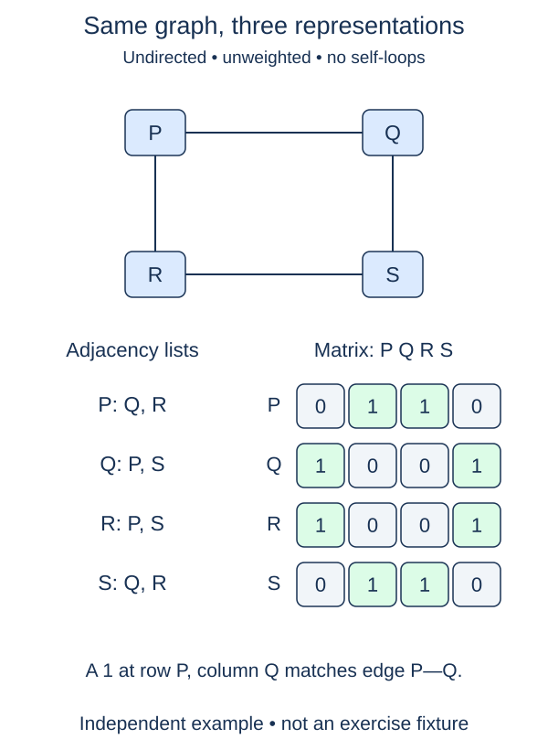

Build a table that answers whether a particular directed connection exists.

A matrix gives each vertex both a row and a column. Cell `[i][j]` is 1 when there is an edge from row vertex i to column vertex j, and 0 otherwise. These are unweighted presence flags, not travel costs. A zero here means no edge; later weighted graphs will need to distinguish a missing edge from a zero-cost edge.

The function accepts a closed adjacency dictionary: every listed neighbor must also be a key. Labels are strings, and dictionary insertion order defines both axes. Return `(labels, matrix)` so the caller can interpret the numeric positions. Returning the matrix alone would lose the link between a station name and its row.

Start with `labels = list(adj)` and a dictionary mapping each label to its index. Allocate a fresh row for every vertex. The tempting expression `[[0] * n] * n` repeats references to one row, so writing one cell changes that column in every row. A comprehension that creates each row separately avoids the problem.

The supplied wrapper calls `zero_matrix` to allocate the rows, then `fill_matrix` to mark edges. These helpers receive ordinary labels, positions, and rows so each change can be checked on its own. For each source and each of its outgoing neighbors, set the corresponding cell to 1. Do not add a reverse entry automatically. An undirected input already contains both directions and will produce a symmetric table. Repeated neighbor entries simply set the same cell again; self-loops, if supplied in this conversion exercise, set a diagonal cell. The input stays unchanged.

This adds a standalone conversion function beside the completed directed graph class. Allocating V squared cells costs O(V²) time and space. Filling them takes O(E) more time with expected constant-time index lookup, so the total is O(V² + E). A matrix is useful for indexed edge queries, but scanning a whole row still examines V cells.

## A small example

```python
labels = ["wash", "dry"]
table = [[0, 1], [0, 0]]
print(labels[0], labels[1], table[0][1])  # wash dry 1
```

## Worked trace



This example is undirected, so both directions are present. The same conversion also accepts directed input without adding reverse edges.

## Your Tasks

1. Build `labels` in dictionary insertion order.
2. Make `zero_matrix` return one independent zero-filled row per label.
3. In `fill_matrix`, set the cell for each outgoing edge to `1`.

Edit `main.py`. Each numbered comment marks one checkpoint; replace its placeholder without changing the supplied code around it. Run shows the supplied probe, and Submit checks each task separately. You can submit after any step.
