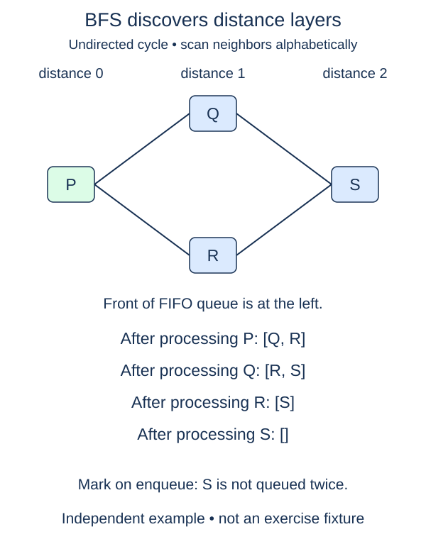

Attach a hop count to each station when BFS discovers it.

A hop is one traversed edge. The start costs zero hops because no move is required. If the current station is k hops from the start, a newly discovered neighbor is k + 1 hops away. This is a shortest distance in number of edges, not necessarily in minutes, fares, or any other edge weight.

BFS makes the first distance final. Its queue processes all distance-k vertices before distance-(k+1) vertices. If there were a shorter route to a newly discovered station, a vertex on that shorter route would already have discovered it. That reasoning depends on treating each edge as one equal step.

Imagine a library with a direct corridor from foyer to archive and a three-corridor detour through reading rooms. The archive receives distance 1 on first discovery. Reaching it through the detour later must not overwrite that distance. The supplied `seen` check enforces this rule; you only fill the two distance assignments.

This is a new standalone function beside the completed traversal. It keeps its own queue and seen set so changing distance calculation cannot alter the earlier `bfs` contract. The returned dictionary contains reachable labels only. An absent key means unreachable, not distance zero. An isolated start gives just its own zero entry, and a missing start still raises `KeyError`.

In the starter, the `if vertex in distances` condition is a temporary safety measure: an unfinished initial assignment must not crash later work. It also makes the first checkpoint testable before the discovery-distance assignment exists. The supplied loop calls `record_hop` only on a new discovery with a recorded source distance. Its small dictionary update is your second checkpoint; you can test it with a supplied distance even before initializing the search. Do not change the supplied queue code.

The function examines each reachable vertex and neighbor entry once, taking expected O(Vr + Er) time and O(Vr) space. Dictionary insertion order records discovery order; the numeric distances do not depend on tie order.

Inputs in this module are closed adjacency dictionaries: every neighbor is also a key. Labels are strings. Lists give outgoing neighbors in the order to follow; the algorithms do not sort them or mutate the input. Repeated entries and self-loops are safe for traversal because discovery is remembered. An undirected input stores each edge in both directions. Unless stated otherwise, a missing start raises `KeyError`, and only the start's reachable region is visited.

Costs assume expected constant-time hashing on short labels. V counts vertices and E counts stored neighbor entries. The examples are small enough for readable traces; a visited set is still necessary even on a small cycle.

## Worked trace

The displayed lists happen to be alphabetical. The implementation follows supplied neighbor order rather than sorting.

## Your Tasks

1. Store distance `0` for the start vertex.
2. In `record_hop`, store the current vertex's distance plus one for its neighbor.

Edit `main.py`. Each numbered comment marks one checkpoint; replace its placeholder without changing the supplied code around it. Run shows the supplied probe, and Submit checks each task separately. You can submit after any step.
